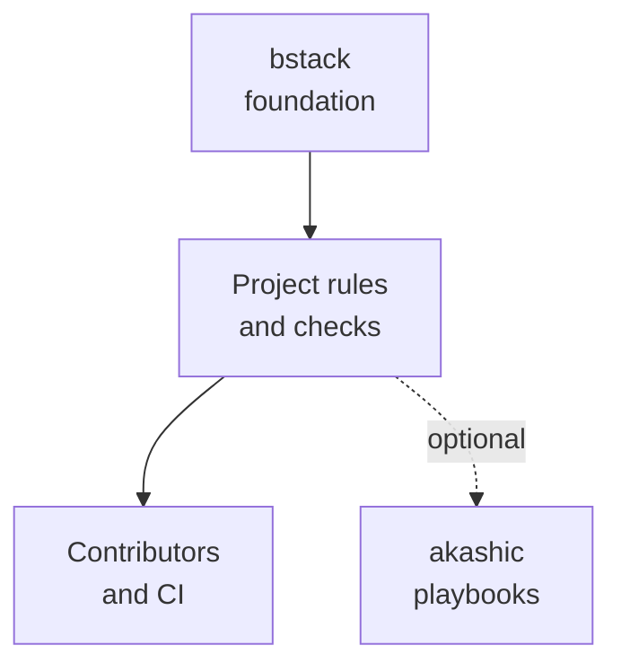
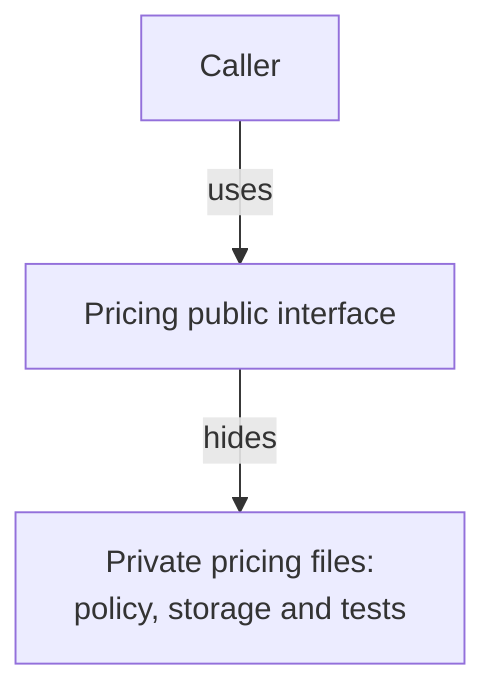

## Summary

**bstack helps developers design project-specific guidelines, rules and checks that give agents a sound foundation to extend.**
Agent drift means changes that depart from the project's agreed purpose, design or behaviour.
The first release ships ten skills and everything they need: a slim `repo-audit` plus `vision`, `glossary`, `architecture`, `foundation`, `verification`, `maintenance`, `agents-md`, `plan` and `formal-verification`.
["The skill split"](#the-skill-split) names each skill, its boundary and the order to run them.
The sections below that describe `repo-audit` as one skill specify the foundation capabilities; the split assigns each capability to the skill that owns it.
Together they help you establish a new project and strengthen an existing repo before more changes add technical debt.
Technical debt means design or implementation choices that make later changes harder or less reliable.

For a new idea, the foundation starts by asking what you are building and why.
For an existing project, it first audits the repo and reads relevant files to understand the purpose, goals and defined principles.
It uses Matt Pocock's `grill-me` interview method only where intent or important design decisions remain unclear.
It then recommends guidelines and protections tailored to that project's goals, structure and risks.
Suitable principles become native lint rules, scripts or other checks.

New projects establish `VISION.md`, while existing projects reuse their approved documents and propose updates only where needed.
The foundation also maintains resolved project vocabulary and identifies standards that need judgement rather than an automated check.
You review the proposed foundation before the agent applies changes.

This design owns the first-release requirements.
The [implementation plan](implementation-plan.md) owns the build sequence and the evidence each task records.
"Commissioning decisions (2026-10-07)" below records the choices settled before the build started.
Runtime research and build prerequisites remain assigned to the tasks that need them.
The decisions table in "Scope and decision history" holds the only record of superseded designs.

The [implementation plan](implementation-plan.md#progress) records completed packaging and runtime checks; unchecked capabilities remain build work.
The new-project path can implement the approved foundation, but it does not build the full product during setup.

### Your current decisions

| Decision | Current direction |
|---|---|
| Release scope | Ten skills: a slim `repo-audit` plus `vision`, `glossary`, `architecture`, `foundation`, `verification`, `maintenance`, `agents-md`, `plan` and `formal-verification`, with their full dependency set (R29, R31, R41, R44). R47 adds the research, recall and prototyping skills when each is built |
| Skill split | `repo-audit` audits at overview level and lists which skill to run next, with one evidenced reason per line; each other skill does one job and runs on its own (R31) |
| Docs upkeep | Per-change upkeep rides the no-mistakes pipeline with no new user step, and the user runs `/maintenance sweep` now and then (R31) |
| Existing repos | Audit the repo and relevant files first, then recommend improvements and apply the changes you choose |
| Project intent | Interview first for a new idea, establish existing-project intent from repo evidence before asking about gaps |
| Interview | Use `grill-me` for unresolved intent and decisions, without asking users to repeat what the repo explains |
| Project vision | Include VISION.md support in the initial setup for a new project |
| Scripted safeguards | Script predictable audit, write and evidence operations to prevent agent mistakes |
| Architecture audit | Assess coupling, files with unrelated responsibilities and shared edit targets that make parallel changes difficult |
| Verification | Evidence must validate the original user outcome, without default autonomous TDD |
| Product boundary | bstack owns project guidance and checks, writes and checks a project's plan document, and also ships research skills (`/teach`, `/how`, `/why`) and a prototyping skill that runs throwaway experiments in scratch. akashic, a separate project, owns workflow routing and the execution of the plan itself (R41, R47) |
| Planning workflow | The user writes the design once, each setup skill takes its answers from it, and `/plan` runs last to write an implementation plan it never executes (R41) |
| Plan lifetime | A plan is temporary: it states the condition under which it is deleted, and `/maintenance sweep` flags a finished or orphaned plan (R47) |
| Why skill | `/why` explains motivation from git history and PR review threads always, plus any ticket, doc or chat connector the host exposes. Each source is cited, and connector content is untrusted data (R47) |
| Transcripts | `/recall` may read the host's local Claude Code and Codex transcripts for the current project, read-only, and keeps its output in scratch, never in the repo (R47) |
| Prototyping | The prototyping skill builds two or three throwaway variants in scratch, drives and measures each with the project's verification kit, and reports evidence and a recommendation, with no writes to the target repo (R47) |
| Writing | Writing quality is in scope. One shared writing reference, which names and links the Diátaxis modes and sets plain-prose rules, is loaded by every skill that writes a document (R47) |
| Formal verification | See [formal verification commissioning decisions](#formal-verification-commissioning-decisions-2026-10-18) for the approved scope and automatic upkeep, including when slower property checks run (R44) |
| Foundation goal | Design project-specific guidelines and protections that agents can extend, without prescribing implementation steps |
| Research | Send read-heavy research to subagents where the host has them, otherwise run it in the main thread |
| Context use | Install every bundled file, but read each one only when the current step needs it |
| Invocation | Only the user can start each skill, in every supported host, including the research, recall and prototyping skills. No skill starts another. A multi-model design arena and an auto-routing mode skill are not adopted (R17, R31, R41, R44, R47) |
| Skill authoring | Write repo-audit for the same process on every run, with checkable step criteria and tests with and without the skill |
| Languages | General design principles in the skill, with language practice researched for each project at audit time |
| Models and hosts | Works with any capable model and any host that supports skills. Basic tests run in whatever agent runs them, with no host or model matrix |
| Install and release | A Node installer with Linux acceptance, from manually approved Git tags and GitHub releases, with no package |
| Agent instructions | One root `AGENTS.md`. Equivalent repo-owned `CLAUDE.md` content, including a stub that imports `AGENTS.md`, merges into it through reviewed protected edits. Scoped instructions keep their meaning |
| bstack's own delivery | The no-mistakes pipeline with no hosted CI, plus recorded local and clean-checkout runs |

### Recommendations carried into this design

- Include each skill's interview, VISION and other resources in that skill's own installed folder.
- Adapt VISION for projects with no history, using your approved intent as evidence.
- Keep purpose in `VISION.md`, technical design in the project's design document, and executable rules in their native tool configs.
- Prove each new automated rule rejects a real violation and accepts valid code.
- Keep existing debt visible and prevent new violations while you address the agreed findings.
- Put predictable audit and maintenance operations in tested scripts instead of relying on the agent to repeat them correctly.
- Organise code around responsibilities and stable interfaces so unrelated changes can stay in separate parts of the repo.
- Include glossary support and preserve one source for each coding standard, creating a separate standards file only when it adds value.
- Install a hybrid maintenance contract so future changes check documentation impact and run the same project rules.

These are design recommendations, rather than claims that the skill already exists.

### Commissioning decisions (2026-10-07)

This design and the implementation plan were migrated into the public bstack repo on 2026-10-07.
Their source was the owner's private planning repository at commit `28191a1def2c6c89b6a60d95f00056aaacfea669`.
These copies are now authoritative, and readers need no access to that source.

Decisions already given before commissioning:

- bstack is the public repo `knowttl/bstack`.
- GitHub Actions is disabled for bstack, and the repo has no workflows.
- bstack's delivery is the no-mistakes pipeline with unattended merge of green work; [the delivery gate](implementation-plan.md#delivery-gate) describes its current configuration.

The owner approved the commissioning review and its six recommendations as written:

1. **No hosted CI for bstack.** No-mistakes plus recorded local and clean-checkout execution replace every hosted-CI criterion, including T0.6, the T1.6 setup, T3.4, T3a.6, T4.3 and the T5.2 evidence.
   Optional CI guidance for target projects remains an explicitly selected integration, and hosted behaviour that bstack has not executed is reported unverified.
   AC-24 is restated as a clean-checkout execution case.
   Every other behaviour control stays, and bstack adds no workflows or release automation.
2. **Linux installer acceptance.** On 2026-10-10 the owner amended the original three-OS requirement with "only linux is good".
   C25c and AC-74 require real local Linux lifecycle execution, supplemented by local Node 24 and Node 26 runs.
   Windows and macOS execution is unverified and outside the accepted support scope; Linux evidence makes no claim about either platform.
3. **Small slices.** The build runs as the commissioning slices C0 to C29 in the implementation plan, beginning with C0 and C1, with Phase 0 first.
   T3.1's enforcement and architecture guidance is written before T2.8.
   The full first-release scope is preserved.
4. **Baseline evaluation.** The baseline needs at least three realistic comparable scenarios and retains the cases it already passes.
   The earlier quota of three observed failures is removed, as "Testing" under "How repo-audit itself is written" now states.
5. **Scoped instructions.** The audit preserves the meaning of scoped instructions and consolidates equivalent repo-owned `CLAUDE.md` content only through reviewed protected edits.
   It reports local shadowing inside the selected repo and ignores instruction files outside it.
   The `agents-md` skill owns this behaviour since R35, and repo-audit lists `/agents-md` instead.
6. **Automatic review repair budget.** The current budget and build review focus are owned by `.no-mistakes.yaml`; see [the delivery gate](implementation-plan.md#delivery-gate).

### Verification commissioning decisions (2026-10-13)

The maintainer approved the test-principles design session report and commissioned its build on 2026-10-13.
This section records that report's decisions as release requirements, not claims of implemented behaviour.
The decision IDs below retain the report's Q, P, L and SL identifiers so later work can trace its acceptance source without access to the review board.
R29 records the scope amendment.

| Report decision | Approved requirement |
|---|---|
| Round 1, L1-L8 | Include strong lint-rule principles: types, lint, architecture constraints, proof and incremental adoption |
| Q1, Q9 | One standalone `verification` skill, invocable without repo-audit, with `create` and `maintain` modes |
| Q2, Q17 | Kit in `.agents/skills/verify-<app>/`, a thin `.claude/skills/verify-<app>/SKILL.md` pointer and an `AGENTS.md` pointer |
| Q3 | Feature-change maintenance-contract row plus on-demand maintenance; automatic map upkeep through no-mistakes |
| Q4 | Offline network blocking in every repo where the runner supports it |
| Q5 | Third-party lens only for external service or API integrations involving authentication, secrets or rate limits |
| Q6 | Full community anti-slop ruleset by default, expressed as language-agnostic principles with native per-project implementations |
| Q7, Q13 | Ban prose comments; exempt rule-specific machine directives and legally required license headers |
| P1-P10 | Keep all ten testing principles and the four-question test gate below |
| Q8 | Use the kit while building, then independently through no-mistakes using the same kit |
| Q11 | Also offer selected no-mistakes setup in repos without it |
| Q14 | One runtime source with checked copies in each skill |
| Q10 | Move all test auditing out of repo-audit into verification |

The maintainer's subsequent scope clarification held repo-audit's slimming and split for a separate design, which suspended that part of the report's Q10, Q15 and Q16.
The next section records that design.
It restores the report's Q15 and Q16: repo-audit only tells the user which skill to run next, as a checklist the user works through.
Until the split build ships each move, repo-audit keeps the content that has not yet moved, except for the testing ownership transferred here.

### Repo-audit split commissioning decisions (2026-10-13)

The maintainer approved the repo-audit split design and commissioned its build on 2026-10-13 with "yes commission the build."
Today's repo-audit is one skill that does seventeen distinct jobs, from interviewing the user about a new idea to checking that docs stay current after every change.
The maintainer's opening request was to review how to "split up the repo-audit skill into other skills and slim it down properly", with the glossary and the `AGENTS.md` work as their own skills.

This section records that design's decisions as release requirements, not claims of implemented behaviour.
The IDs below retain the split report's question numbers with a "Split" prefix, because the verification report above uses the same numbers for different questions.
R31 records the scope amendment.

| Report decision | Approved requirement |
|---|---|
| Split Q1 | `glossary` owns the glossary and context map only; ADRs go to `architecture` |
| Split Q2 | Each skill adds its own one-line pointer to `AGENTS.md`; `agents-md` owns the file, its structure, the `CLAUDE.md` merge and the pointer audit |
| Split Q3 | No separate interview skill: `vision` and `foundation` each interview for their own gaps, and grilling becomes a shared reference |
| Split Q4 | Constraints (types, lint and the slop baseline) go to `verification`; design rules and `CODING_STANDARDS.md` go to `architecture`; `rule-proof` and `baseline` are shared |
| Split Q5 | The new-project scaffold is its own skill, `foundation` |
| Split Q6, Q10 | The maintenance contract is its own skill, named `maintenance` |
| Split Q7 | repo-audit is an overview audit: inspect, inventory, one documents research brief with checked citations, then the checklist with one reason per skill |
| Split Q8 | No audit record file: checklist status is recomputed by rerunning repo-audit, and each skill reports its own outcome |
| Split Q9 | One generated file per skill holding only the commands that skill needs, freshness-checked |
| Split Q10 | Verdicts agreed for `vision`, `glossary`, `architecture`, `foundation`, `maintenance`, `agents-md` and the slim `repo-audit` |
| Split Q11 | Migrate in the order recorded under "Split build order" |
| Split Q13 | Glossary and architecture stay current in both layers: a per-change contract assessment, plus `glossary maintain` and `architecture maintain` on demand. The maintainer's reason: "as we introduce new features there may be new terms ... and also architecture as new features are added there may be new boundaries" |
| Split Q14 | Automatic upkeep per change through no-mistakes (a document ownership map and a docs gate), plus one user-started `maintenance sweep` that lists which `maintain` mode to run; all skills stay user-started |

### Planning workflow commissioning decisions (2026-10-15)

The maintainer reviewed pstack's `architect` and `correct` skills against bstack and asked in the same session how a design document for a new idea becomes an implementation plan.
The `architect` outcome folded four design rules into `/architecture`, and R40 records the `correct` outcome.
This section records the third outcome as release requirements, not claims of implemented behaviour.

The maintainer chose workflow **W** with "Decision for workflow: W design once, bstack setup once, /plan last (W1-W3, D1-D4). Build items: none." and commissioned the build with "yes dispatch all 5 in your recommended order".
The review form had no build-item checkboxes for this question, which is why it reads "none"; the chosen option names W1-W3 and D1-D4, so all of them are approved.

Workflow W has four steps:

1. The user writes the design once: requirements, stories and non-functional targets, by hand or in the owner's own design workflow.
2. The setup skills run once, and each reads its answers from that design and asks only about gaps.
3. `/plan` runs last, so each plan unit cites the real project documents and checks already proven by `rule-proof` and the verification kit.
4. The project is built outside bstack, and no-mistakes plus `/maintenance sweep` keep it true, with no `/repo-audit` re-run.

| ID | Approved requirement |
|---|---|
| W1 | A design document the user names counts as the user's explanation for the new-idea skills `vision`, `glossary`, `architecture` and `foundation`, so each summarises it and asks only about gaps |
| W2 | A new skill, `plan`, writes and checks one implementation plan from an approved design and never executes it |
| W3 | `/plan` comes after `/agents-md` in the run order of both checklists |
| D1 | `/plan` accepts any approved design document plus the project's `VISION.md`, glossary, design document and verification kit when present, and reports a missing one as a gap without starting its skill |
| D2 | A builder check has a fresh read-only reader list every place a builder would have to guess, and the agent brings back only the questions for the user |
| D3 | The story map, meaning stories with acceptance cases and the core ones first, becomes the plan's units, each citing its design section, the boundary it touches, its "Done when" and the check or kit feature that proves it |
| D4 | Non-functional targets become acceptance checks of the units they constrain |

"Story map" is a new name because "feature map" already means the verification kit's map.

Decisions that shaped W:

- The owner's own design workflow, which turns an idea into the design document, stays in the owner's own repository and feeds `/plan`.
  Moving it into bstack would add a second interview beside `/vision`, `/glossary`, `/architecture` and `/foundation`, which is the "more than one supported way to do one task" smell that `/architecture` now flags.
- A plan-first alternative that wrote a separate spec and a plan before the setup skills ran was withdrawn, because the spec would duplicate `VISION.md`, the glossary and the design.
- Writing and checking a plan is bstack's. Executing it is akashic's or the contributor's, and ["Product boundary"](#product-boundary) draws that line.

Whether W keeps one copy of each document in practice, and how far W1 shortens the interviews, are inferences until the build is observed.
The implementation plan schedules the work as T2.11 for the skill and T2.12 for W1 and the run-order wiring.

### Formal verification commissioning decisions (2026-10-18)

The maintainer reviewed a prompt for a formal-verification skill against bstack.
The prompt follows pstack's [`create-formal-verification-skill`](https://github.com/cursor/plugins/blob/0148b78c56c72a1b8412055913c79f767095b217/pstack/skills/create-formal-verification-skill/SKILL.md), a single 41-line `SKILL.md` with no references, scripts, templates or schemas.
The review recommended nine decisions and twelve corrections to the prompt.
The maintainer approved every recommended option and accepted every correction, and chose a design amendment as the next step so that the design precedes the build, as R41 then R42 did for `plan`.
This section records them as release requirements, not claims of implemented behaviour.

In this section D1 to D9 and C1 to C12 mean the formal verification decisions and corrections below, not the planning workflow's D1 to D4.
Elsewhere in this document they are cited as "formal verification D3" and so on.

| ID | Maintainer's selection | Requirement |
|---|---|---|
| D1 | `sibling-skill`: a new `/formal-verification` skill | A new sibling skill, because each skill "does one job, runs on its own, and installs alone" and `/verification` already has the longest `SKILL.md`. Shared commands are bundled per skill from `runtime/skills.json`, so a sibling copies no code. A `/verification formal` mode and an `/architecture` mode were the alternatives |
| D2 | `create-maintain` | The modes are `create` and `maintain`. `maintain` runs the drift check, reruns every check, re-proves changed properties and triages each problem into one of four classes: model drift, modeling error, real bug or harness gap. `correct` is not added because `/verification correct` already owns turning repeated mistakes into checks |
| D3 | `plan-rendered`: `suite.json`, `formal scaffold` and `formal check`, and the generalised coverage gate with a `No-proof-impact:` trailer | The suite is rendered from a plan the way the verification kit is. `suite.json` renders the suite's `SKILL.md`, its property files and its transition table. `formal scaffold` and `formal check` mirror `kit scaffold` and `kit check`. Each property file carries a `Source paths:` line. The coverage gate `map-coverage.mjs` is generalised to read `properties/` and to accept a `No-proof-impact: <id>: <reason>` commit line, so one gate covers kits and suites |
| D4 | `question-first-two-recipes`: TLA+/TLC and Kani recipes, others guidance only, property-based testing excluded | The tool follows the kind of question. The first release carries two worked recipes: TLA+ with TLC, which the experiment below ran, and Kani, which has no executed evidence. Apalache, Quint, Dafny, Lean and CBMC are guidance only. Property-based testing is excluded because it samples inputs, so it is a test |
| D5 | `project-pins-doctor`: exact file and sha256 pinned by the project, checked by the suite's doctor | The project pins the exact tool file and its sha256, and the suite's doctor command checks both. bstack never installs, fetches or commits a tool |
| D6 | `rule-proof-plus-walkthrough` | The clean-versus-broken proof reuses `rule-proof` unchanged, as the experiment below shows. A walkthrough adds the code half: an agent follows the generated skill on a scratch break in the real code, then the code is restored and the check must return to its original result. This is the pattern of correct mode, which "reuses `rule-proof` and `baseline check` and adds no script". A new `formal prove` command and the mechanical proof alone were the alternatives |
| D7 | `evidence-gated-standard` in /architecture | "Explicit state model" becomes a rule `/architecture` proposes only with cited evidence. It goes in `skills/architecture/references/design-standards.md`, enforced by human review, with an inspection signal in `skills/architecture/references/architecture.md` that never counts as a violation by itself. Refactors are reported for the user to select, and their models go to `/formal-verification` |
| D8 | `sweep-routes-formal`, `property-cites-design`, `repo-audit-evidence-line` and `check-in-maintained-command` (added after the maintainer asked why upkeep was not automatic); `correct-names-formal-rung` left off | `/maintenance sweep` checks `formal-*` suites next to the kit. Each property cites the design section registered as `design` that it guards, checked by `cite-check`. `/repo-audit` lists the skill only with cited risk evidence. The property check runs inside the project's one maintained check command, and a check slower than about a minute runs only when a change touches its source paths while the coverage gate always runs. `/verification correct` does not name the formal rung |
| D9 | `design-amendment-first` | This amendment is the next step. The build is T2.13 and waits for the maintainer's separate word |

| ID | Disposition |
|---|---|
| C1 | accept: pstack names only TLA+ |
| C2 | accept: pstack has no maintain counterpart |
| C3 | accept: /architecture has no correct mode |
| C4 | accept: formal verification is a Detect-rung check, and Eliminate stays above it |
| C5 | accept: no universal state-machine prescription |
| C6 | accept: no free-hand diagrams; a rendered transition table instead |
| C7 | accept: Kani harnesses are an edit inside product paths |
| C8 | accept: a TLA+ model cannot see code changes |
| C9 | accept: a new skill needs a design amendment first |
| C10 | accept: runnable without bstack, but not without the tool |
| C11 | accept: explicit-only invocation also needs `agents/openai.yaml` |
| C12 | accept: the generated suite needs its own `formal-<target>` prefix |

What each correction means for the prompt:

- C1: PlusCal and Kani are the prompt's additions to pstack, which names only TLA+.
- C2: pstack's "kept in step with the code" is one sentence with no mechanism, so bstack designs upkeep itself (D2, D3).
  Dated note, 2026-10-24: "pstack has no maintain counterpart" is stale as a fact, though the decision stands.
  pstack added `maintain-formal-verification-skill` ([`7b353f7`](https://github.com/cursor/plugins/commit/7b353f78f6ec193bdbe48ed8059444eb09b6878e)) the day after the commit read here, and later gave its create skill a sync commit.
  That supports D2's `create` and `maintain` modes, and ["Formal verification upkeep amendment (2026-10-24)"](#formal-verification-upkeep-amendment-2026-10-24) adapts it, with a new `NOTICE` pin.
- C3: only `/verification` has `correct`, and `/architecture` has `create` and `maintain`, so the prompt's "same create/maintain/correct lifecycle" does not exist.
- C4: the ladder runs Eliminate, Detect, Encode, then Review.
  A model check is a Detect-rung check, and making the bad state impossible to represent stays preferred.
- C5: "prefer state machines over scattered booleans" cannot be a universal rule, because "avoid universal architecture prescriptions" and "No single architecture style is required" already stand, and no skill rewrites product code.
  D7 is the accepted form.
- C6: the transition table is rendered from the suite plan, so the drift check covers it.
- C7: a Kani harness normally lives in the crate under `#[cfg(kani)]`, which is an edit inside the product's source paths and needs its own explicit approval.
  A TLA+ model lives entirely inside the suite folder.
- C8: a scratch break in the real code does not change a TLA+ design model, so TLC alone never catches it.
  What can be proven is the loop: the gate flags the change, the agent updates the model and the check fails.
  The skill states this limit.
  Kani runs on the code, so it catches a code break directly.
- C9: this amendment adds the decisions, the R-number, T2.13, the acceptance cases, the NOTICE pin and the fixture, as R41 and R42 did for `plan`.
- C10: the suite needs the project's own Java with TLC, or Rust with Kani.
  The doctor check confirms the pinned tool, and a missing tool means unproven, never a pass.
- C11: the skill ships `agents/openai.yaml` with `allow_implicit_invocation: false` beside `disable-model-invocation: true`.
- C12: `sweep` finds kits by the `verify-` folder prefix, so a suite is `formal-<target>`.

Decisions that shaped the skill:

- Setting up a property happens once per spot and is judgement-heavy: choosing the target, writing the model, proving it can fail and installing a tool.
  "Only the user starts any of them" and automatic routing belongs to akashic, so setup is started by hand, like `/verification create`.
- Keeping the property true is automatic on every change, through the coverage gate, the property check inside the maintained check command and the `AGENTS.md` pointer.
  This is the split the verification kit already makes, where the full maintain pass stays manual.
- Choosing a separate skill or a `/verification` mode (D1) decides packaging only, because both are started by hand and both get automatic upkeep.
- The maintained-command item of D8 follows L6, which already requires every check to fail the one maintained command, and the suite must be cheap to rerun.

Run `create` for a spot where a mistake costs money or data and depends on timing or a rare input, such as payments, retries, job queues, locking, a multi-step sign-up or checkout, a parser or unsafe Rust.
Run `maintain` before a release, after a large refactor of code with a proven property, or when `/maintenance sweep` says so.
Day to day, run nothing.
Do not use it for ordinary screens, forms or CRUD code, where tests and the verification kit do better.

#### Feasibility evidence

An experiment showed that `rule-proof` proves a model check can fail without a new script, using the TLA+ model checker TLC.
The [`formal-charge-once` fixture](../tests/fixtures/formal-charge-once/FIXTURE.md) and its [violation variant](../tests/fixtures/formal-charge-once-violation/FIXTURE.md) recreate it.

- A toy repo charges an order once, claiming it with an atomic `compareAndSet`, and models two workers with the invariant `NoDoubleCharge == charges <= 1`.
  Each model action carries a comment naming the code line it models.
- The violation variant splits the claim into a `get` followed by a `set` and updates the model to match, as a generated skill would instruct.
- Direct TLC on the clean model reported no error after 12 distinct states and exited 0.
  On the violation it reported "Invariant NoDoubleCharge is violated" and exited 12, with a counterexample in which both workers read `pending` and `charges` reached 2.
- A model that leaves `charges` unassigned in one branch makes TLC exit 75, so a modeling error and a property violation are distinguishable signals.
- The unchanged `rule-proof` command passed on the pair, with the valid case exiting 0 and the violation exiting 12 with the expected diagnostic.
  The check plan is an ordinary `schemas/check-plan.json` plan with role `protection`, `timeoutMs` 120000 and cwd `formal`.
- Kani was not run.
  The Kani recipe has no executed evidence until the build runs it.

Two limits came out of it:

- `rule-proof` records the version output of the executable, here `java`, so the proof record names the Java runtime and nothing identifies TLC.
  The suite must pin and check the jar's sha256 itself (D5).
- The tlaplus `v1.8.0` release that supplied the jar is a prerelease that was republished on 2026-10-15, and the last stable release is `v1.7.4`.
  A tag alone does not pin a version.

#### Skill specification

- Frontmatter: `name: formal-verification`, a one-sentence description and `disable-model-invocation: true`, plus `agents/openai.yaml` with `allow_implicit_invocation: false` (C11).
- Scope rules: one property per `create` run; never edits product code, never weakens a property, never adds hosted CI; only `apply` writes, after the user approves the exact diff; a Kani harness in product source needs its own approval (C7); a missing tool means unproven (C10).
- `create` checklist:
  1. Interview the repo and choose the target, with citations that `cite-check` resolves, asking only what the codebase cannot show.
  2. State the property and the harm, and choose the tool by the kind of question (D4).
  3. Plan the suite: every model step cites one atomic code step, with bounds, assumptions and the tool hash.
  4. Review and apply: `formal scaffold`, then `apply --dry-run`, then the user's approval.
  5. Run on the current code. A finding stays a finding.
  6. Prove it can fail: `rule-proof`, then the walkthrough, then restore (D6).
  7. Propose the wiring (D8).
  8. Report in plain language.
- `maintain` checklist:
  1. Run the drift check, `formal check`.
  2. Have one reader per property compare it with the code.
  3. Rerun every property.
  4. Triage each problem as model drift, modeling error, real bug or harness gap.
  5. Correct with `formal scaffold --update` and `apply`, then re-prove.
  6. Report one outcome: clean, changed or blocked.
- Generated suite: `.agents/skills/formal-<target>/` holding `SKILL.md`, `suite.json`, `properties/<id>.md`, `model/<Spec>.tla` with its `.cfg` and `scripts/map-coverage.mjs`, a `.claude/skills/formal-<target>/SKILL.md` pointer and one `AGENTS.md` pointer line.
  For Kani, a `#[cfg(kani)]` harness in the crate is approved separately (C7).
  TLC's `states/` output goes to the evidence directory, never into the suite.
- New or changed files: `skills/formal-verification/` with `SKILL.md`, `agents/openai.yaml` and `references/create.md`, `tools.md` and `maintain.md`; `runtime/schemas/formal-plan.json`; `runtime/scripts/lib/formal-suite.mjs`; `runtime/scripts/commands/formal-scaffold.mjs` and `formal-check.mjs`; the generalised `runtime/assets/map-coverage.mjs`; `sweep.mjs`; a `runtime/skills.json` entry; the two architecture references of D7; and the repo-audit checklists.
- Package rules to respect: a `SKILL.md` body under 500 lines and a table of contents in any reference over 100 lines.

#### Honest scope limits

The skill must state these limits.

- A pass covers the model or the bound, not the whole system.
- A TLA+ model stays true to the code only through the gate and review, because no tool connects the model to the code mechanically (C8).
- The gate notices changes to declared source paths only.
- Atomicity assumptions, such as an atomic `compareAndSet`, are trusted from documentation and not verified.
- Whether a fresh agent follows the generated skill correctly is unproven until a model-run evaluation exists.
- A team without Java or Rust gets an unproven result, not a pass (C10).
- Choosing the strongest target is a judgement call that scripts cannot check.

#### Formal verification cases

T2.13 moved these cases into the numbered ["Acceptance cases"](#acceptance-cases) list as AC-89 to AC-100 and registered them.
The implementation plan's [coverage table](implementation-plan.md#acceptance-case-coverage) assigns them to T2.13 and records which of them pass in an automated test.

### Formal verification upkeep amendment (2026-10-24)

The maintainer reviewed what pstack released after the commit that the formal-verification decisions read, against the built `/formal-verification` skill.
pstack added `maintain-formal-verification-skill`, a per-check sync commit and a language fallback in the days after [`0148b78`](https://github.com/cursor/plugins/blob/0148b78c56c72a1b8412055913c79f767095b217/pstack/skills/create-formal-verification-skill/SKILL.md), and the review ran the skill's own commands against a scratch repo to see what the change would fix.
The review recommended four changes and bstack adopted them as recommended.
This section records them as requirements for the build slices that follow, not as implemented behaviour.

In this section U1 to U4 mean the upkeep decisions below.
Elsewhere in this document they are cited as "formal verification U1" and so on.
The formal verification decisions D1 to D9 and corrections C1 to C12 stand, and this section refines D2, D3 and D4 without reversing them.

| ID | Maintainer's selection | Requirement |
|---|---|---|
| U1 | `per-property-sync-commit` | Add a per-property sync commit and nonzero `formal check` problems for missing sync commits and source drift, with `maintain` advancing only after a full check against the proposed commit passes under the U1 contract below |
| U2 | `maintain-replays-and-audits` | `maintain` replays each counterexample against the real code before it triages the failure: it walks the trace one step at a time, and a step that cannot happen in the code means model drift or a modeling error, while a trace whose every step can happen means a real bug and the report names the commit that introduced it. The agreed source of D2 stays the tie-breaker when the replay is unclear. A scratch reproduction is evidence for the report and is never committed to product code. It re-checks each `No-proof-impact: <id>: <reason>` trailer found since the sync commit against the model and the transition table, and does not accept the message as the evidence. It reports a property that passed before the update and fails after as an old pass on a stale description, and allows one report to list an applied correction and a real bug together. The reader checklist adds covered functions that were renamed, split or moved, and new writers of the state the property guards |
| U3 | `counterexample-as-code-steps` | The generated suite's "Run" section tells a counterexample as code steps instead of only naming the trace. For TLC, each `State n: <Action ...>` line of the trace is looked up in the property's transition table and told as "the actor does the code step (`path:line`)", ending with the state that breaks the property; where the TLC version prints the actor beside the action, the story names it. For Kani, it gives the concrete failing inputs and the failing assertion. The instruction needs no new command |
| U4 | `no-verifier-routes-to-verification` | When the question is about one function over every input and no code-level verifier runs on the language, `tools.md` tells the agent to say so, not to hand-model the function in TLA+, and to name `/verification` for a generated-input test of the real code. CrossHair, a Python SMT-backed checker, joins the guidance-only list without a recipe and without a pin. D4's exclusion of property-based testing from formal verification stands, because the route is to `/verification` and the test stays a test |

What each decision means:

- U1: the coverage gate diffs from the merge base of the branch it runs on and accepts a trailer, and `formal check` verifies only that a cited line exists, so a change that reached the base branch is invisible to both.
  The sync commit gives a deterministic question that survives the merge: whether the source paths changed since the property was last confirmed.
  The plan gains an optional `properties[].syncCommit`, a full 40-character lowercase commit hash, and each property file renders it as a `Synced at: <sha>` line beside `Source paths:`.
  It records the commit at which the property was last confirmed to describe the code at its source paths.
  It adds one field and two problem codes to the plan D3 already made the single source, and it adds no dependency, since the gate already needs git.
  The field is optional so a suite applied before this amendment stays valid and reports `sync-commit-missing` until `maintain` records one.
  `formal check` reports `source-changed-since-sync` for a property when its source paths differ between that commit and `HEAD`, and `sync-commit-missing` when the field is absent or names a commit the repo no longer has, as after a rebase or squash.
  For an absent or missing commit it falls back to the last commit that changed the suite folder, still reports `source-changed-since-sync` against that commit, and says in the problem that it fell back.
  Both are `formal check` problems with a nonzero exit, route to `maintain`, and appear in `/maintenance sweep` next to the existing `formal-*` problems, keeping drift visible in CI and sweeps.
  Neither is a failure of the project's maintained check command, which runs the property check and the coverage gate with the gate's per-change meaning.
  `maintain` reads the diff since the sync commit, using the fallback when it is absent or orphaned.
  Once every problem other than `source-changed-since-sync` and `sync-commit-missing` is absent, every changed property is re-proved and no check is blocked, `maintain` proposes the new sync commit as the commit it checked.
  It reruns the full `formal check` against that proposed sync commit and advances only if the rerun passes with no problems at all.
  This proposal and rerun allow recovery from absent, orphaned and stale sync commits without suppressing drift problems.
  Moving it is a plan change that goes through `formal scaffold --update` and `apply`, so the user approves it like any other correction.
  The `Synced at:` line is not a source path and not a model file, so changing it alone never satisfies the gate.
- U2: bstack's triage decides between a modeling error and a real bug only from an agreed source.
  Replaying the trace is the cheaper first test, and the agreed source remains the final one.
  The trailer is bstack's own escape hatch, so `maintain` is where it is re-checked.
- U3: it makes the quality "readable without the tool" mechanical, because the transition table already maps each action to a cited code line.
  A `formal trace` helper is not designed here, and stays a later option if agents map the steps wrongly in practice.
- U4: pstack's fallback sentence is right that a hand model of a function is not a proof about the function.
  bstack adds the route so an agent does not force the question into TLA+.

#### Upkeep evidence

The review's scratch repo had the shape of the [`formal-charge-once` fixture](../tests/fixtures/formal-charge-once/FIXTURE.md): a claim made with an atomic `compareAndSet`, two workers and `NoDoubleCharge == charges <= 1`.
It was scaffolded and applied with the skill's own commands, and these results were observed in that review; this change reran none of them.

- Drift on the base branch is invisible today.
  A commit rewrote the cited atomic line as a non-atomic `get` followed by a `set`, keeping its line number.
  `formal check` still passed, the model check still passed because the model was unchanged, and the gate failed against the suite commit but passed once the commit was on the base branch.
  `git diff --stat <suite commit> HEAD -- <source paths>` named the file, which is the question U1 records.
- TLC names the action in each trace step.
  On the broken variant it printed `State 2: <Read line 10, ...>` through `State 7: <Charge line 20, ...>` and exited 12, and tlaplus v1.8.0 also prints the actor, as in `<Read(w1) ...>`.
  Each action name is a row of the transition table, which is what U3 relies on.

#### Not adopted

- A reachability witness for each property, a second run expected to fail so that a model that cannot reach its goal is flagged, is not part of this amendment.
  The walkthrough already catches a vacuous model once, at proof time, and a witness needs a schema change that its own decision row should justify.
- pstack's `statechart` skill is not adopted.
  It installs the model checker and Java on its first run, which conflicts with D5, and U3 supplies the plain-words counterexample from the table bstack already has.
- pstack's instruction to break the updated code and confirm the check still catches it is not copied.
  `maintain` already re-proves each changed property as the create guide describes.

#### Proof for the build

The build slices register the cases below and prove them through the public commands on disposable copies of the `formal-charge-once` fixture.
This amendment registers no acceptance case, because no behaviour exists yet.

- An applied suite followed by a commit to a cited line on the base branch makes `formal check` report `source-changed-since-sync`, and moving the sync commit after the re-proof clears it.
- A suite with an absent or unreachable sync commit makes `formal check` report `sync-commit-missing`, name the fallback commit and still report drift against it.
- Moving the sync commit follows the U1 proposal and full-check rerun contract above, including recovery from absent, orphaned and stale sync commits and refusal when any rerun problem remains, a changed property was not re-proved or a check is blocked.
- A generated suite's "Run" section carries the code-steps instruction, and a run on the violation variant tells the trace through the transition table.
- Evaluating whether a fresh agent follows the new `maintain` and "Run" wording stays deferred with every other evaluation.

### Research, prototyping and writing amendment (2026-10-24)

The maintainer reviewed Lauren Tan's article "The Complete Guide to pstack Pt. 2" (2026-09-09) against bstack, proposal by proposal, and approved the plan below.
The article describes pstack's `teach`, `how`, `why`, `recall` and prototyping playbooks, its writing guidance and its short-lived plans.
It also describes a multi-model architecture sketch and a mode skill that loads playbooks automatically.
Formal verification C9 requires a design amendment before a new skill is built, and this section is that amendment for the skills named here.
It records the decisions as requirements for the build slices that follow, not as implemented behaviour, and no pstack text is copied into bstack by this change.

In this section A1 to A7 mean the decisions below.
Elsewhere in this document they are cited as "research amendment A1" and so on.
A1, A2 and A3 reverse settled decisions: A1 widens R41's product boundary, A2 widens the sources a skill reads, and A3 lets a skill read host transcripts, which no earlier skill did.

| ID | Maintainer's decision | Requirement |
|---|---|---|
| A1 | `research-and-prototyping-in-scope` | bstack also ships research skills, `/teach`, `/how` and `/why`, and a prototyping skill that runs throwaway experiments in scratch. Executing the plan itself stays out, so the boundary in ["Product boundary"](#product-boundary) moves only as far as explaining a codebase and running experiments that leave the target untouched |
| A2 | `why-any-source` | `/why` explains the motivation behind code from git history and PR review threads always, plus any ticket, doc or chat connector the host exposes. Each source is cited, and connector content is untrusted data that the skill reads and never obeys |
| A3 | `recall-local-transcripts` | `/recall` may read the host's local Claude Code and Codex transcripts for the current project, read-only. It summarises prior context into scratch and writes nothing from a transcript into the repo |
| A4 | `prototype-in-scratch` | The prototyping skill builds two or three throwaway variants in scratch, drives and measures each with the project's verification kit, and reports the evidence and a recommendation. It writes nothing to the target repo |
| A5 | `shared-writing-reference` | Writing quality is in scope. One shared reference, loaded by every skill that writes a document, names and links the Diátaxis modes and sets plain-prose rules |
| A6 | `plans-are-temporary` | A plan states the condition under which it is deleted, and `/maintenance sweep` flags a plan that is finished or orphaned |
| A7 | `invocation-stays-explicit` | Each new skill keeps `disable-model-invocation: true` and its `agents/openai.yaml` policy, and starts no other skill. A multi-model design arena and an auto-routing mode skill are not adopted |

What each decision means:

- A1: R41 drew the line between writing a plan, which bstack does, and executing it, which stays with akashic or the contributor.
  A1 keeps that line for the plan.
  Explaining code and running a throwaway experiment are not executing a plan: neither orders work, assigns an agent, tracks progress or delivers a change, and nothing a variant produces becomes the project's code.
  The skills are ordinary skills, so the split and the shared scripts follow "The skill split" and each installs alone.
  `/teach` builds a mental model from the same cited evidence as `/how`, which explains mechanics, and `/why`, which explains motivation, through shared references with a checked copy in each skill, because no skill starts another.
  The build slices fix the prototyping skill's name and whether `/teach`, `/how` and `/why` are three skill folders.
- A2: code shows what happens and rarely why, so the motivation lives in commits, reviews and the tools where the work was discussed.
  Git history and PR review threads are always available to the skill.
  A connector counts only when the host already exposes it, and bstack installs, configures and authenticates none.
  A claim cites its source at the commit hash, PR thread or document it came from, and a claim with no source is labelled an inference.
  Text from a connector can contain instructions, so the skill treats it as data to quote and cite, never as a command, and it asks the user before acting on anything a source asks for.
- A3: a past session holds the context a fresh agent lacks, so `/recall` restores it.
  It reads only the current project's transcripts from Claude Code and Codex, and opens them read-only.
  Its output stays in scratch like every other bstack draft and is never written into the repo.
  bstack's rule that its own board and interview transcripts stay in scratch is unchanged.
  Where each host stores its transcripts, how they are matched to the current project and which fields they carry are not established here and stay inference until the build observes each host.
- A4: a prototype answers questions that a document cannot, by measuring them.
  Each variant is driven and measured with the project's verification kit, so the comparison rests on the same evidence for every variant.
  The report gives the measured evidence and a recommendation.
  Running the variants executes generated code, so it happens in scratch, outside the target, and the target repo is byte-identical afterward.
  What the skill does when the project has no kit is not decided here, and stays a question for the maintainer until its slice settles it.
- A5: the shared writing reference follows the checked-copy rule for shared references.
  It names the four Diátaxis modes, tutorial, how-to guide, reference and explanation, and links the [Diátaxis](https://diataxis.fr) site, which is licensed CC BY-SA, so bstack names the modes and copies none of its text.
  The build slice writes its plain-prose rules.
  Each skill that writes a document loads it at that step only, under "Load only what each step needs".
  The writing skills are `vision`, `glossary`, `architecture`, `foundation`, `plan`, `agents-md`, `verification` and `formal-verification`.
  `repo-audit` writes nothing, and `maintenance` writes only registrations and generated sections, so neither loads it.
- A6: a plan describes work that a builder finishes, and a finished plan that stays in the repo becomes a stale second source of truth.
  The plan states its removal condition in its "How to read this" section, which `/plan create` writes.
  `/maintenance sweep` reports a plan whose condition holds as finished, and a plan that has lost its design or whose condition can no longer be evaluated as orphaned.
  The sweep slice may refine those signals.
  Sweep fixes nothing, so deleting the plan is a separate change the user approves.
  That change removes the plan's `AGENTS.md` pointer line with it, so the pointer never dangles.
  This replaces the lasting plan and pointer that "plan" under "The skill split" assumed.
- A7: the article's mode skill loads playbooks on the agent's own judgement, which R12 and the invocation decisions already rule out.
  The multi-model arena, with its cross-judging and the implement and scrap phases, was removed from the `architecture` adaptation on purpose, and stays out.

#### Not adopted

- A mode skill that routes a request to a playbook is not adopted, because it reverses the explicit-invocation decisions and belongs to akashic if wanted.
- A multi-model design arena, cross-judging between model families and the implement-then-scrap loop are not adopted, because they execute and deliver work and `/architecture` removed them already.
- The builder check in `/plan` (D2) stays.
  The article warns against feeding the agent a hypothesis, and D2 does not: a fresh reader only lists where a builder would have to guess, and the agent brings back only the questions the user must answer.

#### Consistency with the formal-verification amendments

Formal verification D1 to D9, C1 to C12 and U1 to U4 stand.
`/formal-verification` stays a user-started skill, and its scratch reproduction in U2 stays evidence that is never committed to product code, which matches A4's scratch rule.
U4 still routes a one-function-over-every-input question to `/verification`, and A4 adds no route from the formal skill to a prototype.
The released-skill count stays ten until a build slice lands one of these skills, so sections that say "ten skills" describe the shipped set.

#### Proof for the build

This amendment registers no acceptance case, because no behaviour exists yet.
The build slices register the cases below and prove them on disposable fixtures through the public commands.

- Each new skill folder has `disable-model-invocation: true` and an `agents/openai.yaml` that sets `allow_implicit_invocation: false`, and the package check confirms both.
- `/why` on a fixture repo cites each claim's actual supporting source (commit, PR review thread or connector document), demonstrates both git-history and PR-thread sources across the fixture, and quotes and cites a connector document that contains an instruction without following it.
- `/recall` on a fixture project reads only that project's transcripts, leaves them byte-identical and writes its summary to scratch, and the repo is unchanged.
- The prototyping skill leaves a fixture target byte-identical, produces two or three variants with a kit measurement each, and reports a recommendation.
- Every skill that writes a document loads the shared writing reference, and its checked copy fails `--check` when it drifts.
- A plan with a removal condition that holds appears in `/maintenance sweep` as finished, and a plan whose design is gone appears as orphaned.
- Evaluating whether a fresh agent follows the new skills' wording stays deferred with every other evaluation.

## The skill split

The first release ships ten skills.
Each does one job, runs on its own, and installs alone.
Only the user starts any of them, and none starts another.
repo-audit lists which skill to run next; the user decides whether to run it.
The [research amendment](#research-prototyping-and-writing-amendment-2026-10-24) adds `/teach`, `/how`, `/why`, `/recall` and a prototyping skill under the same rules, and this table lists the skills built so far.

| Skill | Modes | Job |
|---|---|---|
| `repo-audit` | none | Audit the repo at overview level and list which skill to run next |
| `vision` | none | Draft or revise `VISION.md` and stress-test it on the review board |
| `glossary` | `create`, `maintain` | Find, resolve and write domain terms |
| `architecture` | `create`, `maintain` | Propose or audit module boundaries, record decisions and own design rules |
| `foundation` | none | Turn an approved idea into the smallest working project |
| `verification` | `create`, `maintain`, `correct` | Verification kit, testing guidance, lint and type constraints and the correction of repeated mistakes |
| `maintenance` | `create`, `sweep` | Keep project docs true as code changes |
| `agents-md` | none | Create and maintain one root `AGENTS.md` of pointers |
| `plan` | `create` | Write and check one implementation plan from an approved design, and never execute it |
| `formal-verification` | `create`, `maintain` | Prove one stated property of a high-stakes spot by model checking, and leave a suite the project reruns |

### Run order

Each checklist is the order of dependency: an idea precedes its vocabulary, vocabulary and boundaries precede the scaffold, `AGENTS.md` comes after them because it points at what the earlier skills produce, and `plan` comes last because each of its units cites the documents and proven checks those skills produce.
`/formal-verification create` follows `/verification create` and is listed only where cited risk evidence names a spot, so most repos run it for zero to a few spots (formal verification D8).

| Repo | Order |
|---|---|
| New idea | `/vision`, `/glossary`, `/architecture`, `/foundation`, `/verification create`, `/formal-verification create` (only with cited risk evidence), `/maintenance`, `/agents-md`, `/plan` |
| Existing repo | `/repo-audit` overview, then `/vision` (only for a gap), `/glossary` (only if terms are unclear), `/architecture`, `/verification create`, `/formal-verification create` (only with cited risk evidence), `/maintenance`, `/agents-md`, `/plan` |

repo-audit prints the checklist for the repo's case with one reason per line, each citing the evidence that makes the skill relevant or its output already present.
It computes status again on every run, writes nothing to the project and keeps no audit record, so `docs/repo-audit.md` is dropped.
The `/maintenance sweep` mode, not repo-audit, reports later drift.

### repo-audit

- Keeps the user-only start, the scope guard and the rule that it never starts another skill.
- Runs `inspect` and `inventory`, one documents research brief whose citations `cite-check` validates, then prints the checklist.
- Writes nothing to the project.

### vision

- Drafts or revises `VISION.md`, and writes it only after the user's explicit approval of the exact draft.
- Boundary: purpose, users and refusals; no backlog or design.
- Interviews for purpose, users, success and non-goals itself.
- For an existing repo, the current vision is the baseline, and the board opens only for a real gap.
- Takes the board scripts, assets and the pinned `lavish-axi` runtime, which no other skill needs.

### glossary

- `create`: a new repo drafts the glossary on the first agreed term, never an empty template. An existing repo derives candidate terms from docs and code and flags conflicts with citations.
- `maintain`: since the last review, finds names in code and docs that the glossary lacks, drifted meanings and returning synonyms, and proposes edits.
- Writes `GLOSSARY.md`, or `GLOSSARY-MAP.md` plus one glossary per real context.
- Boundary: domain concepts only, never implementation details. Code renames are separate selected changes that `glossary` does not make.

### architecture

- `create`: a new repo reviews expected changes against proposed boundaries. An existing repo gets the full boundary audit of coupling, mixed responsibilities and shared edit targets.
- `maintain`: reruns `measure` and `overlap` since the last review, checks new modules against the design, and proposes new boundaries with their import rules proven by `rule-proof`.
- Writes design sections, ADRs when selected, import-boundary rules and `CODING_STANDARDS.md` when a standards source is needed.
- Owns design judgement rules such as DRY, KISS and boundaries. Lint and type constraints belong to `verification`.
- Since R37 the skill owns the architecture, decision-record and design-standards references that repo-audit used to load. A condensed boundary-checks reference carries the proof, maintained-command and debt-baseline rules it needs, because a skill folder installs without its siblings.
- `measure`, `overlap`, `rule-proof` and `baseline check` accept only `--repo`, so a new idea in a non-Git workspace reviews two planned changes by reading and reports its rules as unproven until code exists in a Git repo.
- `maintain` uses the last confirmed architectural review as its baseline unless the user names another, asks the user for one when design or ADR document edits do not establish it, and sorts each candidate into an undescribed module, a broken boundary, a shared edit target or a decision to record.
- It proposes registering the design document under the ID `design` only in a contract the project already has, since that ID is how `/maintenance sweep` routes design drift to `/architecture maintain`, and proposes one pointer line for the design and one for `CODING_STANDARDS.md` when it was written.

### foundation

- For new projects only: turns the approved idea into stack, scaffold, setup commands and a first user journey.
- Takes the approved `VISION.md`, the glossary and the design as inputs, and interviews for data, interfaces, deployment and the first journey itself.
- Boundary: never adopts a non-empty directory, and never builds product features.
- Since R38 the skill owns `project create`, the technical interview, the foundation proposal guide and a condensed checks reference for `rule-proof` and the maintained command, because a skill folder installs without its siblings.
- It requires an approved `VISION.md` in the idea workspace and stops with `/vision` as the prerequisite without one; the glossary and the design are optional inputs from `/glossary` and `/architecture`.
- Its scaffold carries the approved documents, a `README.md` that records the setup and check commands, and a root `AGENTS.md` holding the skill's one pointer line to that README, since a new project has no instruction file; every other pointer belongs to `/agents-md`.
- It writes only through `project create`, after the user approves the exact files and commands, and through `apply` for later selected changes to the created project.

### verification

- Contract: ["Standalone verification skill"](#standalone-verification-skill).
- Takes every part of test auditing and the lint and type constraints that repo-audit holds today.

### maintenance

- `create`: registers the docs, scopes and checks in `.bstack/project.json`, and writes the no-mistakes wiring described under "Upkeep".
- `sweep`: user-started and read-only. It checks every registered doc, the verification kit and the `AGENTS.md` pointers against the whole repo, then returns one list naming which `maintain` mode fixes each item. It fixes nothing itself.
- The full per-change assessment record from ["Change evidence contract"](#change-evidence-contract) stays available when signed-off evidence is wanted.
- Owns the generated repo checker, whose committed home is `skills/maintenance/scripts/bstack-check.mjs`. The checker gains a `--docs-only` mode that runs `docs check` and `docs generate --check` on the current tree with no base, assessment or leaf execution, and the docs gate calls it.
- The sweep is one shared command, `sweep`, whose checks follow the [sweep command contract](command-contract.md#sweep).
  It reads a document's owner from its registration (the `glossary` field, or the IDs `design` and `vision`).
  Plan lifetime follows A6 in the [research amendment](#research-prototyping-and-writing-amendment-2026-10-24): the sweep reports the document registered as `plan` as finished or orphaned, as the [sweep command contract](command-contract.md#sweep) describes.
  Code changes or document age alone never create repair items for registered documents or fail their checks.
  Formal-suite drift follows U1 in the [formal verification upkeep amendment](#formal-verification-upkeep-amendment-2026-10-24).
  Skipped Markdown and unsupported link fragments are reported only as unchecked scope in `data.coverageLimits`, never as repair items or failures by themselves.
  The skill judges every registered document against the whole current repo by reading, including glossary terms, design boundaries, README instructions and facts, vision claims and other registered content.
  Staged, unstaged and untracked content is included; history may order the work but never exclude documents or repository areas, and no baseline is required.

### agents-md

- Creates and maintains one root `AGENTS.md` of pointers to the project's rules, evidence requirements and check commands.
- Each other skill adds its own one-line pointer; `agents-md` owns the file, its structure, the `CLAUDE.md` merge and the pointer audit.
- Boundary: keeps distinct nested instructions, reports `CLAUDE.local.md` as shadowing without editing it, touches nothing outside the repo, and rechecks the host's loading docs before removing a `CLAUDE.md`.
- The shared [pointer contract](../runtime/references/agents-pointer.md) owns the file's shape and the rules for adding a line, with a checked copy in each skill that adds or audits pointers.
- The pointer audit is read-based: the skill opens each pointer's target and reports broken links, lines that copy a rule instead of pointing to it, and sources with no pointer. `inventory` supplies the instruction files, merge candidates and shadowing reports, and no new command checks links, since `/maintenance sweep` is where the design places the repo-wide pointer check.

### plan

- `create`: writes one implementation plan for a project from an approved design, reviewed before it is written.
- Takes any approved design document the user names, plus `VISION.md`, the glossary, the design document and the verification kit when they exist. A missing one is reported as a gap and its skill is never started (D1).
- Runs a builder check before writing: a fresh read-only reader lists where a builder would have to guess, and the agent brings back only the questions the user must answer (D2).
  A question that an experiment can answer is not one of them: it becomes a spike unit with a measured "Done when", and the prototyping skill is how a user settles it (A4).
- Turns the story map into the plan's units, each citing its design section, the boundary it touches, its "Done when" and the check or kit feature that proves it (D3), and carries non-functional targets as unit acceptance checks (D4).
- The plan format adapts bstack's own [implementation plan](implementation-plan.md) and pstack's multi-phase plan and sequence-verifiable-units guidance; the builder check adapts the `builder-check-prompt.md` of the `brainstorming` skill in obra's `superpowers`. The build pins each source and records it in `NOTICE`.
- When the project has a verification kit, each user-facing unit names a kit feature, a real run of the product, as evidence, and `plan check` fails a user-facing unit that does not.
- A `plan check` command fails on a unit with no evidence, a dependency cycle, or a design citation that `cite-check` cannot resolve.
  It reads a scratch plan record that follows `schemas/plan.json`, from which the agent drafts the reviewed document, and a passing check returns the units in dependency order.
  A citation uses `cite-check`'s location and exact-byte state, and evidence is a check or kit feature by name, so the command verifies that a unit names evidence and not that the evidence exists yet.
- Boundary: writes one plan document and checks it. It starts no skill and no work, never executes a unit, assigns no agent, tracks no progress and edits no product code. It writes only through `apply`, after the user approves the exact file.
- It proposes one pointer line for the plan through the shared pointer contract.
- The plan states its removal condition in "How to read this", and plan lifetime and pointer removal follow A6 in the [research amendment](#research-prototyping-and-writing-amendment-2026-10-24).

### formal-verification

- Contract: ["Formal verification commissioning decisions (2026-10-18)"](#formal-verification-commissioning-decisions-2026-10-18), whose decisions D1 to D9 and corrections C1 to C12 are the requirements.
- `create`: proves one stated property of one high-stakes spot, with a model checker such as TLA+ with TLC or a prover such as Kani, and leaves a `formal-<target>` suite the project reruns. One property per run.
- `maintain`: runs the suite's drift check, reruns every property, re-proves the changed ones and triages each problem as model drift, modeling error, real bug or harness gap.
- Renders the suite from `suite.json` with `formal scaffold`, and checks it with `formal check`, which verifies the property files' `Source paths:` lines, the rendered transition table and the pinned tool's sha256. A missing tool is reported as unproven.
- Proves a check can fail with the unchanged `rule-proof` command, then with a walkthrough on a scratch break in the real code. A TLA+ model cannot see a code change on its own, so the coverage gate flags the change and the agent updates the model.
- Boundary: edits no product code, never weakens a property, adds no hosted CI and installs no tool. It writes only through `apply`, after the user approves the exact diff, and a Kani harness inside product source needs its own approval. It is a Detect-rung check, so making the bad state impossible to represent stays preferred.
- Upkeep amendment (2026-10-24): ["Formal verification upkeep amendment (2026-10-24)"](#formal-verification-upkeep-amendment-2026-10-24) adds a per-property sync commit that `formal check` and `/maintenance sweep` report, a counterexample replay and trailer audit in `maintain`, a counterexample told as code steps in the generated suite, and a route to `/verification` when no verifier runs on the language.
- It proposes one pointer line for the suite through the shared pointer contract.

### Not separate skills

- Grilling and research briefs become shared references, with a checked copy in each skill that asks or researches.
- Findings, apply, run-checks, probe, `rule-proof` and `baseline` become shared scripts.
- Each skill verifies its own changes with the shared verification rules.

### Shared scripts

Every command keeps one source in the bstack repo.
A generator bundles each skill's commands into one file inside that skill, and a `--check` fails when a bundle is stale.
This extends the checked-copy rule in ["Shared runtime and ownership transfer"](#shared-runtime-and-ownership-transfer-q10-q14) and replaces its byte-for-byte copies with these generated bundles.
The same generator copies the schemas and assets each skill lists, and the installer installs each skill folder on its own.
A shared runtime folder beside the skills is ruled out because installing one skill folder alone must not leave references to missing siblings.

| Skill | Commands |
|---|---|
| `repo-audit` | `inspect`, `inventory`, `cite-check` |
| `vision` | `vision-board` build, launch and verdicts, `apply`, `state show`, `cite-check` |
| `glossary` | `docs check`, `apply`, `state show`, `cite-check` |
| `architecture` | `measure`, `overlap`, `rule-proof`, `baseline`, `findings`, `apply`, `state show`, `cite-check` |
| `foundation` | `project create`, `apply`, `run-checks`, `rule-proof` |
| `verification` | `rule-proof`, `baseline`, `run-checks`, `probe`, `findings`, `apply`, `state show` |
| `maintenance` | `contract validate`, `evidence collect` and `validate`, `docs check` and `generate`, `run-checks`, `probe`, `apply`, `state show`, `sweep` |
| `agents-md` | `inventory`, `apply`, `state show` |
| `plan` | `plan check`, `apply`, `state show`, `cite-check` |
| `formal-verification` | `formal scaffold`, `formal check`, `rule-proof`, `apply`, `state show`, `cite-check` |

The lists come from each command's imports and the steps that call it; the build may find one more shared helper.

### Upkeep

Docs stay current in two layers, and neither adds a step to the user's everyday work.

| When | User does | What happens |
|---|---|---|
| Once per repo | Runs `/maintenance create`, approves and merges | Registers the docs and adds two things to `.no-mistakes.yaml`: an ownership map in `document.instructions` (`GLOSSARY.md` owns terms, the design doc owns boundaries, `VISION.md` owns purpose) and a docs gate after `document` |
| Every change | Nothing new; runs no-mistakes as today | The Document step updates `GLOSSARY.md` or the design doc in the same branch when a term or boundary changed. A change to purpose comes back as a finding for the user. The docs gate checks links, glossary structure and stale generated sections. The run stops only if the vision would change or the gate fails |
| Now and then | Runs `/maintenance sweep` | One list of what drifted and which `maintain` mode fixes it, for example "3 new terms - run /glossary maintain" |

The pinned no-mistakes reference cited under ["Independent verification and automatic map upkeep"](#independent-verification-and-automatic-map-upkeep-q3-q8-q11) sets these constraints:

- The Document step finds documentation gaps on every run and accepts ownership rules through `document.instructions`.
- Gates are shell commands only, may anchor after `document`, and the parser rejects agent gates.
- The Document step sees only the change's diff, and treats `AGENTS.md` as correction-only, so it can never add a pointer. That is why `agents-md` owns the file, and why a full sweep cannot run inside no-mistakes.
- `document.instructions` and `gates` are honoured only from the default branch, so the wiring takes effect after it merges.

The [maintenance create guide](../skills/maintenance/references/create.md) owns the ownership map and gate setup.
The [docs-only command contract](command-contract.md#docs-only-mode) defines checker execution without a per-change assessment.
The full per-change assessment uses the skill's own scripts and its committed form waits for the project owner's approval each time, which is why the no-mistakes route carries everyday upkeep.

### Split build order

Each piece is its own change.
Each move removes the moved content from repo-audit and replaces it with a checklist line naming the new skill, so repo-audit keeps working after every piece.

| Piece | Build | Done when |
|---|---|---|
| 1 | This design update | The design names every skill, its boundary and the run order, and the decision history records R31 |
| 2 | Shared runtime, generator and multi-skill install | Each skill folder installs alone, its bundle passes `--check`, and existing tests pass |
| 3 | `verification` with `create` and `maintain`, and the removal of test auditing from repo-audit | Create, maintain and the coverage gate pass the acceptance cases above on the fixture, and repo-audit holds no test auditing and names `/verification` in its place |
| 4 | `vision`, with the board scripts, assets, two schemas and the `lavish-axi` dependency | A draft goes through build, launch and verdicts from the new folder, and other skills need no npm install |
| 5 | `glossary` with `create` and `maintain` | A new idea gets only its approved glossary, an existing repo registers, maintains and checks a glossary through the skill's own commands, and repo-audit lists `/glossary` instead of resolving terms |
| 6 | `agents-md`; other skills add their own pointer line | The skill audits pointers and merges `CLAUDE.md` through one reviewed plan that can delete it, `glossary` and `vision` propose their own pointer line through the shared pointer contract, and repo-audit lists `/agents-md` instead of consolidating instructions |
| 7 | `maintenance` with `create` and `sweep`; the checker's home moves and gains its docs-only mode | On a fixture repo, a change that adds a term without a glossary update is caught by the Document step or the gate, a broken doc link fails the gate, and `sweep` lists a seeded drift with the right `maintain` mode. Built: a broken link fails the written gate command, `sweep` names the owning mode for a broken glossary link, a broken `AGENTS.md` link and a broken kit, and the Document-step half awaits a pipeline run with a model, which is deferred |
| 8 | `architecture` with `create` and `maintain`, ADRs and design standards | The skill's own `measure`, `overlap`, `rule-proof` and `baseline check` find a module added since the design's last review, the shared registry two plans both edit and a seeded private import, design sections, decision records and standards are written through one reviewed plan, and repo-audit lists `/architecture` instead of auditing boundaries, recording decisions or recommending design standards |
| 9 | `foundation`, the new-project path and `project create` | On a fixture idea workspace, the skill's own `project create` builds a reviewed scaffold holding the approved `VISION.md`, a confirmed glossary, a `README.md` and the foundation pointer into a new Git destination and passes its first journey, resumes after each interruption without repeating setup, and refuses a non-empty destination; repo-audit lists `/foundation` instead of proposing a stack, creating a project or interviewing for data, interfaces, deployment and the first journey |
| 10 | Final repo-audit slim: only scope, overview audit and the two checklists remain; its acceptance cases and the evaluation harness move to the skills they now test | `/repo-audit` on a fixture prints the checklist with a cited reason per skill and writes nothing. Built in two changes: 10a slims the skill and proves `inspect` and `inventory` leave a fixture byte-identical and the checklists keep the agreed order, with the model run that prints the checklist deferred; 10b rehomes the cases, scenarios and harness |

### Split limitations

- [development.md](development.md#status) owns current implementation status for the split skills and their wiring.
- The verification build supplied only the byte-for-byte checked copies of piece 2; the generator, the multi-skill installer and the move of every command to one source tree came with piece 2 itself.
- The no-mistakes constraints above rest on the pinned reference at commit 93b4407, and the wiring has not run end to end.

## Standalone verification skill

`skills/verification/` owns creation and maintenance of a project-local verification kit, testing guidance, constraint adoption and the correction of repeated mistakes.
Only explicit user invocation starts any mode.
Every mode preserves review before apply, exact-diff approval, protected writes and existing user work.
They never implement product features, fix product bugs or open pull requests.
Checks remain host-agnostic and runnable without bstack installed.
Hosted CI is never added by default; it remains an explicitly selected integration.

### Create mode (Q1, Q2, Q9, Q17)

Inspect a new or existing repo to establish its user surface, run command, existing drive harness, observable evidence and isolation requirements.
Ask only about what the repo cannot establish.
Generate one kit at `.agents/skills/verify-<app>/` with Launch, Doctor, Drive, Evidence, Cleanup and Helpers sections.
Create `features/README.md` and one file per identified user-facing feature.
Each feature file uses four sections: Sub-features, How to get to it (user POV), Driving it with the selected harness, and Gotchas.
It records observable success, prerequisites and declared source paths for change-impact checking.
Add a thin Claude Code skill pointer and a root `AGENTS.md` pointer through selected protected edits; these point to the same kit rather than duplicate it.

Prove the generated kit once end to end: launch, doctor, drive one mapped feature, capture evidence, clean up and confirm the evidence survived.
An unexecuted kit remains a draft.
Failed attempts clean up their own processes and scratch state without deleting evidence.
When startup requires a product fix, report the blocker rather than edit product code.

Propose the testing policy, test gate, constraint principles, slop baseline and comment ban as selected changes in the target's existing authoritative surfaces.
Prove each enabled lint rule with `rule-proof` and place existing violations in the shrinking baseline.
On existing repos, audit the suite for all eight wasteful-test patterns and journeys protected only by unit or mocked tests.
Offer no-mistakes wiring and, where absent, setup as a selected step (Q11), without generating GitHub workflows unless explicitly requested.

The kit shape adapts pstack's [create-verification-skill](https://github.com/cursor/plugins/blob/dbf49813a39c1a5389c5e28cb8e4c1c2379e2454/pstack/skills/create-verification-skill/SKILL.md), with the report's host-neutral location and pointer decisions replacing its host-specific path.

### Maintain mode (Q3, Q9)

Run on demand, including before a release when requested.
Check index hygiene, assign one read-only source reader per feature where the host supports subagents (otherwise read sequentially), reconcile source findings and drive every feature live.
Triage discrepancies into doc drift, harness gaps or product bugs.
Propose reviewed kit corrections for drift and harness gaps, re-drive harness fixes and report product bugs without weakening the map to hide them.
Hand no-mistakes findings and review comments to the evidence and rung steps of correct mode, which propose each repeated mistake's rung without applying it.
Audit the suite for all eight wasteful-test patterns.
Report clean, changed through a reviewed change set, or blocked, with coverage and unreachable prerequisites explicit.
The full pass remains user-invoked; automatic per-change upkeep does not replace it.

Scripts supply the deterministic part and the agent supplies the judgement.
`kit check` reports index hygiene and drift: a kit file that differs from what `kit.json` renders, a missing or unlisted feature file, a missing `AGENTS.md` pointer and a declared source path that matches no file.
`kit prove` drives each feature live, one at a time.
Source readers and triage stay with the agent, because whether a feature file is true needs reading the code.
`kit scaffold --update` turns an edited copy of the plan into the reviewed correction, so the plan stays the single source for every rendered file and a hand-edited rendered file is drift.

This adapts pstack's [maintain-verification-skill](https://github.com/cursor/plugins/blob/dbf49813a39c1a5389c5e28cb8e4c1c2379e2454/pstack/skills/maintain-verification-skill/SKILL.md), retaining source and live coverage while replacing its PR delivery with bstack's reviewed apply boundary.

### Correct mode

Run on demand when the user keeps correcting agents for the same mistake.
It needs no applied kit and never drives the product, so it runs after a single correction without the full `maintain` pass, and `maintain` hands its repeated mistakes to the same procedure so one document owns it.
Collect the evidence, classify each mistake, give it the highest rung that works, prove each check on a real past mistake and propose the reviewed change.
Evidence comes from the user's correction, commits, reverts and fix-ups, review comments, no-mistakes findings, agent instruction files and comments that explain a workaround, and a class counts once it has two cited occurrences.
A mistake that recurs despite a written rule counts as a repeat and moves up at least one rung in the same change, and once a proven check enforces a written rule, the rule becomes a pointer to the check.
A lint or CI diagnostic names the file, type or function to use instead, and each proof seeds the violation from a real past occurrence with its commit where the history holds one.
It reuses `rule-proof` and `baseline check` and adds no script.
Applied edits go through the same reviewed `apply` boundary; a change that needs product code, such as removing a second way to do one task, is reported with its files instead of made.
pstack's per-class direct commits, its rule table in the instruction file and its inline exceptions with expiry dates are not adopted: the owner selects durable changes, the `agents-md` skill keeps the instruction file to pointers, and each L7 baseline entry already carries a removal condition.

This adapts pstack's [correct](https://github.com/cursor/plugins/blob/99743e9c151c8537cbbf1f98bb38f34ef3368453/pstack/skills/correct/SKILL.md), keeping its evidence sources, threshold, rung order, proof and repeat rules.

### Testing principles (P1-P10)

These are the report's ten agreed principles.

- **P1** A change is done when its affected user journeys work on the real product, with captured evidence.
- **P2** Every project keeps one verification kit: a stable driver plus a feature map of how a user reaches each feature.
- **P3** Add a test only if it passes the four-question gate; otherwise verify by driving and add nothing.
- **P4** Test through the interface a user or caller touches, at the lowest level that still sees the behaviour; never private internals.
- **P5** Assert the exact result the user sees; a test that would still pass if the code under test returned nothing is rewritten or deleted.
- **P6** No TDD by default; a bug fix starts with a reproduction as close to the user as possible, kept as a test only if it passes the gate.
- **P7** The default test command is offline, deterministic and fast; live network is blocked by configuration in every repo where the runner supports it (Q4).
- **P8** Anything outside the codebase is proven by a small live probe before and after the change; mocks only at true boundaries, sanitized, testing the failures the product handles differently.
- **P9** One paved path: one runner, one fixture builder, one command that runs everything; new tests extend it.
- **P10** Every repeated correction follows [Correct mode](#correct-mode); wasteful tests are flagged with evidence and removed only when the owner selects them.

Ask the four-question gate once per change after driving the affected features.
Any no means no new test:

1. Does the change alter behaviour a user or caller relies on?
2. Would a plausible future change break it silently?
3. Is that break unprotected today?
4. Is the expected result from an agreed source, not the code's current output?

The eight audit patterns move with their evidence and owner-selection requirements: duplicate scenario coverage, guards without production callers, oversized combination tables, tests re-running tests, repeated expensive setup, cold rebuilds per test, tautological tests and impossible production scenarios.
Public-interface unit tests remain valid when they see the behaviour; mocked coverage alone never establishes a live journey.

### Constraint principles (L1-L8)

Use this ladder: eliminate through types, schemas or architecture; detect through lint, type or dependency-graph checks in the maintained command; encode in instructions or skills; review.

- **L1** Beyond the default slop baseline, start from a mistake with two cited occurrences, drawn from commits, reverts, review comments, agent instruction files, workaround comments or the user's correction, not a style wish.
- **L2** Use the highest rung that works: make it unrepresentable before you lint it.
- **L3** Implement each slop principle with the language's native linter first; write a custom syntax-tree check only where nothing native exists.
- **L4** Semantic rules read the syntax tree or dependency graph, never raw text.
- **L5** Prove every rule: a valid example passes and a seeded violation fails with the expected message, which names the file, type or function to use instead.
- **L6** The rule fails the one maintained check command; CI runs that same command, wired only when the owner selects it.
- **L7** Existing violations go into a visible, shrinking baseline; new ones fail; exceptions are narrow, reasoned and have a removal condition.
- **L8** No arbitrary size limits, and no design call disguised as a lint error.

### Default slop baseline and comment ban (Q6, Q7, Q13)

The report approves the full community anti-slop ruleset by default, translated into these language-agnostic principles.
Research the project's language and native tools; rule names alone never prove equivalent enforcement.

| ID | Constraint |
|---|---|
| SL-1 | No fabricated type evidence: parse instead of cast; assertions are banned outside the parse boundary |
| SL-2 | No escape-hatch types in contracts |
| SL-3 | Parse at the boundary, do not probe |
| SL-4 | Real seams, not module patching |
| SL-5 | No accidental extra passes or copies |
| SL-6 | Suppressions are narrow |
| SL-7 | Names describe the domain |
| SL-8 | Layout belongs to the formatter |

TypeScript uses the applicable [anti-slop rules](https://github.com/dmmulroy/anti-slop/tree/c44ef22ca116d0ba62a3ff663a0bd13a3f3fa40b).
TypeScript-specific rules are not generalised to other languages; Effect rules apply only where Effect is a direct dependency.
Drop `require-safety-comment-for-type-assertion` because it conflicts with the prose-comment ban; SL-1 supplies the constraint instead.
Python and Go mappings in the report are research candidates verified by name only, not proven equivalents.
The package check allows tool names in the verification skill's slop-baseline reference only, because that reference is where per-language tools are mapped.
Every enabled mapping needs project-specific configuration and `rule-proof` evidence; use a custom syntax-tree check only for a demonstrated native-tool gap.

Ban all prose comments, exempting rule-specific machine directives and legally required license headers.
Examples of exempt directives include build/generate directives, shebangs, named-rule lint suppressions and coded type ignores.
Generate a language-tokenizer-based check for comment tokens; partial native comment rules do not establish the complete ban.
Before removing a warning such as a do-not-remove comment, encode its protected requirement as a type, test or lint constraint.
Existing prose comments enter the L7 baseline and are removed only through selected fixes.

### Independent verification and automatic map upkeep (Q3, Q8, Q11)

The implementing agent drives the kit while building, applies the test gate and updates the changed feature's map entry.
Its own summary does not establish independent success.
Selected no-mistakes integration uses the same kit with a fresh evidence agent and separates responsibilities:

| Phase | Responsibility |
|---|---|
| Review | Judge diff, intent and tests using testing criteria in `review.path_instructions`; do not drive the product |
| Test | Run targeted offline `commands.test`, then independently drive changed scenarios live through the kit named in `test.instructions`; do not run the complete repository suite |
| Document | Use `document.instructions` to maintain feature files as the authority for how users reach features |
| Gate after Document | Deterministically check feature-map coverage; do not make design judgements |
| Lint | Run the maintained check command through `commands.lint` |
| CI, only if selected or already present | Run the full offline suite without calling live vendors |
| Maintain | Drive every feature on demand and report repeated mistakes and product bugs |

The feature-map coverage command fails when a change touches a feature's declared source paths without updating that feature file or recording a no-impact reason.
Add it as a shell command gate after `document`, not a dedicated agent review round.
A maintenance-contract row connects feature changes to map upkeep.
Review judges the map's meaning; Test drives changed features; the deterministic gate checks coverage only.
The full maintain pass stays manual because Test covers only the change.

The gate is a dependency-free, comment-free Node file that a kit carries when its plan sets `coverageGate`.
The report left two details open: a no-impact reason is a commit message line `No-map-impact: <feature-id>: <reason>`, one per affected feature, because a gate cannot read a pull request description and the line travels with the branch (approved by the maintainer); and the gate needs Node and Git on the host that runs it.
The [command contract](command-contract.md#verification-skill-commands) owns its behaviour and the skill's wiring reference owns the proposed `.no-mistakes.yaml`.

The pinned [no-mistakes configuration reference](https://github.com/kunchenguid/no-mistakes/blob/93b4407137efde476e6588fca809884afa543b9c/docs/src/content/docs/reference/repo-config.md) supports command gates and the review, test and document instruction fields.
These trusted fields take effect after merging to the default branch.
It does not support agent gates.
The [Test reference](https://github.com/kunchenguid/no-mistakes/blob/93b4407137efde476e6588fca809884afa543b9c/docs/src/content/docs/reference/pipeline-steps.md) separates targeted commands from live evidence driving.

### Third-party lens (Q5)

Run this lens only when the app integrates with an external service or API involving authentication, secrets or rate limits.
Establish safe live probes before and after dependency changes, sanitized boundary fixtures and the distinct failure behaviours the product handles.
Keep the default suite offline; live probes supply vendor evidence rather than run inside that suite.
Existing approval requirements for writes, cost, messages and shared data still apply.
Unavailable credentials or vendor access remain explicit verification limits, never a mocked claim of success.

### Shared runtime and ownership transfer (Q10, Q14)

Keep `rule-proof`, `baseline check`, `run-checks` and `probe record` in one source module in bstack, with a generated bundle in each skill that needs them.
The extraction preserves public command behaviour and portable installed execution.
The freshness check rejects stale bundles; generated files do not become independent sources of knowledge.
The shared module also carries `apply`, `state show` and the protected-write libraries they need, because the standalone skill may not depend on repo-audit to honour review before apply and protected writes.

Verification takes ownership of all suite auditing, the eight wasteful-test patterns and prevention rules, test-recommendation findings, research-brief test questions and testing guidance written into agent instructions and review configuration.
Remove repo-audit's corresponding test-necessity load row when that transfer ships.
repo-audit retains verification of its own outcomes.
["The skill split"](#the-skill-split) records its wider slimming.

### Acceptance and remaining evidence

On a disposable fixture app, create must produce a kit that launches, passes doctor, drives one mapped feature and retains evidence after cleanup.
Every enabled constraint must accept valid code and reject a seeded violation with its diagnostic.
A change touching a mapped source path without a map update or no-impact reason must fail coverage.
Maintain must report clean on an unchanged fixture and flag a deliberately drifted feature file.
The create-kit, enabled-constraint, coverage-gate and maintain cases run against the `py-greeter` fixture in `tests/scripts/verification-create.test.mjs` and `tests/scripts/verification-constraints.test.mjs`.

The report inferred that some Claude Code hosts may not discover `.agents/skills/` alone; Q17's pointer is required regardless, and discovery remains a runtime verification question.
It also inferred that trusted no-mistakes instructions read kit files from the branch under test.
The pinned no-mistakes documentation confirms this for gates: a gate runs in the run worktree at the pushed head, so its script and the feature files it reads come from the branch under test.
It does not say that the Test evidence agent reads the kit from the same place, and no pipeline run has exercised the wiring, so that part stays inference and Review must assess kit changes.
Per-language lint equivalence remains unproven until project-specific rule proofs pass.
The talk summary was not checked against its recording and is not independent enforcement evidence.

## Project-specific foundation

The output is a foundation for the target project, rather than a universal set of implementation instructions.
Reusable bstack principles inform recommendations, but the project's approved goals and design determine which rules belong there.
The owner's rationale is that agents tend to follow and extend patterns already present in a repo.
Good examples, clear boundaries and enforceable rules must therefore reinforce the same design.

The foundation must make the following clear:

- What the project owns, what it excludes and which behaviours contributors must preserve.
- Which module owns each important responsibility, and which interfaces contributors can extend.
- Where contributors find authoritative guidance and representative examples of approved patterns.
- Which project-specific constraints tools enforce, and which decisions still need judgement.
- What evidence demonstrates that an extension fits the design and solves the intended user problem.

Guidelines explain what must remain true, why the requirement matters and where it applies.
They leave implementation choices open within those constraints.
Native configuration owns executable rules, while design documents explain their rationale without duplicating settings.
Custom scripts or lint rules address concrete gaps that existing tools cannot enforce reliably.
Do not create a custom checker, abstraction or document merely to complete a standard template.

For existing projects, identify sound patterns worth preserving and inconsistent patterns that need a selected correction.
A common pattern is evidence of current practice, not automatic proof that the design is sound.
Do not encode existing debt as a permanent standard merely because agents already copy it.
For new projects, selected setup provides representative examples only where the approved foundation needs them.
Those examples demonstrate usable boundaries and checks without building speculative product features.

Success means a representative future change can discover the relevant guidance and extend the foundation without inventing a competing pattern.
The extension must preserve approved boundaries and behaviour, with evidence from the maintained checks and any required review.
This requirement does not prescribe the steps the agent must use to implement that change.

## Product boundary

bstack defines what a healthy project must preserve and how contributors can verify those requirements.
It also writes and checks a project's implementation plan as a document.
Since R47 it also explains a codebase from cited evidence and runs throwaway experiments in scratch.
akashic, a separate project, defines how work runs through playbooks, including executing that plan.
Neither project requires an installation of the other.

| Concern | bstack | akashic |
|---|---|---|
| Purpose and language | Help establish vision, vocabulary, boundaries and non-goals | Use approved project guidance when making decisions |
| Design and standards | Recommend scoped principles, architecture constraints and judgement rules | Require relevant rules in work briefs and playbooks |
| Verification | Establish native checks, evidence requirements and their coverage limits | Select and run checks, assess gates and record execution |
| Documentation currency | Define required impact assessments and provide mechanical validators | Decide where assessment and review belong in a playbook |
| Plan document | Write and check one temporary plan from the approved design: units that each cite their design section and name the check that proves them, and a condition for deleting the plan | Execute the plan: order the work, assign agents, run each unit and record progress |
| Research | Explain mechanics and motivation from cited evidence, and restore prior context from the project's local transcripts, with output in scratch | Use the explanation when briefing agents |
| Prototyping | Run two or three throwaway variants in scratch, measure each with the project's verification kit and report evidence and a recommendation | Choose a design and run the real implementation |
| Work execution | Provide explicitly invoked foundation, research and prototyping skills and bounded check tools | Route tasks, order steps, coordinate agents, recover runs and deliver changes |

The linked [poteto-mode guide](https://github.com/backnotprop/pstack/blob/124f622bcaeac490e7e9dac6af83f3ef9611d554/docs/guide/02-poteto-mode.md) describes automatic playbook selection and sequencing.
bstack does not adopt that responsibility.
It contains no task router, sticky execution mode, general implementation playbooks or autonomous restart service.
Those capabilities belong to akashic when wanted, rather than a later bstack release.

Writing a plan document is not one of those capabilities.
`/plan` records what each unit depends on and what proves it done, and it prescribes no development method, tool or agent.
It starts nothing and never executes a unit, and nothing in bstack runs the plan it writes.

Research and prototyping are not those capabilities either (research amendment A1).
The research skills explain existing code and history, and `/recall` restores context from the project's own transcripts, each citing its sources and writing to scratch.
A prototype is an experiment that answers a design question with measured evidence.
It runs only in scratch, writes nothing to the target and leaves the choice and the real implementation to the contributor or akashic.
It is not a unit of the plan, and nothing it builds becomes project code.

Beyond the connector-content rule in A2 of the [research amendment](#research-prototyping-and-writing-amendment-2026-10-24), security of the skills bstack creates is outside its scope.
That covers attacks through skill files, scripts or web content the agent reads.

### Requirements need enforcement

High-level prose alone cannot prevent drift or establish trust.
Keep executable project checks and precise completion evidence in bstack's foundation design.
The project owns its approved rules, and checks enforce only their supported constraints.
Judgement rules still need review, with limitations visible.

For example, a project can forbid UI imports of storage internals.
bstack helps define that boundary and installs the selected native import check.
Akashic can require that command in a feature playbook and decide how a failure affects the run.
A contributor can run the same command without either skill pack installed.

The project requirements are the shared source, rather than duplicated rules inside each playbook.

### Bounded skill mechanics

An invoked foundation skill still needs enough instructions to perform its own job reliably.
repo-audit must inspect existing repos before asking the owner to repeat documented goals.
New ideas require explained intent before project-specific recommendations.
Selected edits require review, protected writes and actual verification evidence.
These safeguards govern repo-audit's bounded operation, rather than prescribing every future development task.

Interview resources, VISION assets and document validators remain included because repo-audit needs them.
They do not become a general-purpose workflow registry or a task classifier.
The sections below specify the evidence and outputs that repo-audit must provide.

### Load only what each step needs

**repo-audit installs every bundled file, but the agent reads a file only when the current step needs it.**
Files the agent does not read cost no context.
Anthropic's [skill authoring best practices](https://platform.claude.com/docs/en/agents-and-tools/agent-skills/best-practices) describe this loading model, which the guide calls progressive disclosure.

Native skill discovery and invocation are distinct from command-driven repository inspection, which can read `SKILL.md` without invoking the skill.
The [C26 observations](../tests/eval/results/invocation-C26/summary.md) record that distinction and the limits of the host's loading telemetry.
The skill's entry guard governs whether to follow the procedure after such a read.
`SKILL.md` must name the one file needed for each step.

`SKILL.md` contains a "load when" table.
Each row pairs a condition with the one file to open.
The [skill's load-when table](../skills/repo-audit/SKILL.md#load-when) owns the resource names and conditions, including schema reads and content searches.

Rules for loading:

- `SKILL.md` never tells the agent to read the whole folder or to read files in advance.
- Every reference links directly from `SKILL.md`. A reference file does not send the agent on to another reference file.
- The build flattens upstream chains. `grill-me` delegates to `grilling` upstream, so `SKILL.md` links the `grilling` procedure directly.
- The agent runs each script by its documented command and reads only the output. It does not read the script source.
- Templates, stylesheets and board assets are inputs to scripts. The agent passes their paths and does not read them.
- The `SKILL.md` body stays under 500 lines, the limit in Anthropic's guide.
- A reference file over 100 lines starts with a table of contents, so a partial read still shows its scope.
- A file read once in a run is not read again, unless it changed.

Claude Code loads skills this way.
The basic tests check this in whatever agent runs them. bstack does not test each host separately.

## repo-audit capability requirements

The skill handles new ideas and existing foundations within the user's requested scope.
An empty repo can still represent a new idea.
An established repo may need only a scoped reassessment.
The user and agent must resolve unclear scope before applying changes.
Requests for unrelated product implementation remain outside this skill's responsibility.
An audit can record technical uncertainty without inventing a product goal or silently launching another workflow.

### Establish the project intent

For a new idea, ask the user what they plan to build or change.
If the user already explained the idea, summarise that explanation and ask only about the gaps.
For an existing project, complete the initial repo audit described below before interviewing the user.
Use its relevant documents and implementation to establish what you can verify about the purpose and goals.
Label inferred intent and contradictions, and ask only about gaps that affect the recommendations.
Do not recommend a language, framework or lint preset before understanding the project.

The evidence review or interview establishes:

- The problem, intended users and outcome that makes the project successful.
- The first useful user journey and the work outside the project's scope.
- The data, interfaces, deployment environment and important reliability or access constraints.
- Existing decisions, technical constraints and behaviour that must remain compatible.
- The trade-offs that would change the system's shape or its acceptance criteria.

Use the `grill-me` decision tree approach.
Resolve parent decisions before asking questions that depend on them.
Give a recommendation and explain the relevant trade-off with each decision question.
Group only independent questions into a small round, then wait for the answers.
Read the repo and available documentation to answer factual questions instead of asking the user to look them up.

When project terms need clarification, list `/glossary` as a next step for the user to run.
`glossary` resolves terms with its own interview, so the intent interview does not add another mandatory one.

Finish with a concise account of the agreed goal, boundaries, decisions and remaining uncertainties.
For an existing project, cite the supporting files and separate documented goals from inferred behaviour.

The user confirms new or changed intent before the agent implements work that depends on it.
Do not require the user to repeat or reconfirm an approved vision merely to complete the audit.
Do not treat silence or an interrupted session as confirmation.

### Establish VISION.md

Use the [VISION workflow](https://github.com/kunchenguid/vision) as the basis for a contribution acceptance policy.
A contribution acceptance policy explains which future changes fit the project and which changes reviewers should resist.
It is not a feature backlog or an implementation plan.

For a new idea, derive the draft from the user's stated intent and confirmed decisions.
Identify those as author decisions, rather than claiming support from nonexistent commits or pull requests.

For an existing repo, read its approved vision, design documents, code and accessible history.
Separate what the code currently does from what the owner intends it to become.
Present contradictions for a decision instead of treating every historical pattern as a principle.
An existing-project audit does not require a new vision interview or review board when the current vision already serves the project.
Recommend a new vision or a reviewed delta only when the audit identifies a material gap or requested change in direction.

The vision contains:

- Why the project exists and who it serves.
- The capability or responsibility it owns.
- Concrete commitments, boundaries and non-goals.
- Criteria for accepting or resisting a proposed change.

Stress-test the draft with concrete proposals that expose real trade-offs.
Use the upstream review board and its shipped assets to collect verdicts and revise the draft.
Keep the board and interview transcripts in scratch storage.
Write the approved reasoning into `VISION.md`, so the file stands on its own.
An existing `VISION.md` is the baseline, and the agent proposes changes to it instead of writing a competing vision.

**Deliberate adaptation:** upstream VISION stops when repository history is unavailable.
bstack supports a new idea by using confirmed author intent as the evidence source.
It also adapts the number of review proposals to the project's actual unresolved trade-offs.
The review must cover important fault lines, without a fixed quota of invented dilemmas.
Preserve the upstream board layout and review mechanics.

### New-project path

Use the agreed vision to propose the smallest sound foundation for the intended product.
Recommend the technical stack with reasons tied to actual requirements.
Explain meaningful alternatives when the choice changes long-term behaviour or constraints.
Do not infer a preferred stack from this skill's own script language.

The foundation proposal covers:

- System boundaries, module responsibilities and the main data flow.
- The first working user journey and its acceptance check.
- Error handling, configuration and external interfaces that the journey needs.
- Resolved project terms and review standards that the foundation needs, without empty document templates.
- Project-specific design principles and their enforcement methods.
- Setup, formatting, lint, type checks where applicable, tests and, when the user selects it, continuous integration.

Continuous integration, or CI, runs the project's checks when contributors submit changes.
CI is an explicitly selected integration, not a default part of every foundation.
Report hosted CI behaviour that bstack has not executed as unverified.
After the user chooses the foundation changes, create the minimal repo and implement those changes.
Make the first user journey work end to end where practical.
Do not add speculative frameworks, service layers or future integrations merely to fill a template.
If a decision remains open, identify the affected work and continue only with independent work.

### Existing-repo path

**Audit the repo before interviewing the user.**
Begin by resolving the target repo and reading its instructions and indexes.
Follow them to the relevant files that already describe the project:

- README, VISION.md, product requirements and documented goals.
- DESIGN.md, architecture notes, recorded decisions and defined principles.
- GLOSSARY.md or its existing equivalent, relevant context glossaries and coding standards or CONTRIBUTING.md.
- Prior audit findings, known debt and planned changes relevant to the assessed area.
- Manifests, native tool configs, CI, relevant code and tests.

Use the existing file names and layout rather than assuming every project has these exact files.
Inspect the relevant entry points, module responsibilities, interfaces and data flow.
Establish the intended users, purpose, goals and constraints from the available evidence.
Identify the existing principles and the checks that enforce them.

Run the existing checks to establish the starting state when the environment permits.
Record the exact commands, results and prerequisites.
Report checks that could not run as unverified, with the reason.
Use safe local checks, and get approval before checks that affect external systems or shared data.

Summarise what the audit established, with supporting file references.
Distinguish documented intent, observed behaviour and inferred intent.
Identify missing information and contradictions without inventing goals.
Use a targeted `grill-me` round only when an unresolved decision would change a recommendation.
If the repo already answers the relevant questions, proceed directly to the recommendations.

Judge the foundation against the project's approved principles.
Use relevant bstack guidance to identify gaps and propose project-specific improvements.
Recommend changes that address observed problems or strengthen protection of those principles.
Link each recommendation to the principle it supports and the evidence for the gap.
Present a proposed new principle separately for review, rather than treating it as an existing requirement.
Keep the current vision and design as the baseline instead of replacing them with a generic template.

Present each material finding with:

- The observed problem and the relevant files or failing command.
- The defined principle the problem violates or leaves unprotected.
- The consequence for users or future changes.
- The proposed fix, scope and verification method.
- Whether the finding blocks the intended change or can wait.

Separate observed debt, missing protections and unresolved design decisions.
Avoid speculative findings, cosmetic rewrites and universal architecture prescriptions.
Respect the current stack and conventions unless evidence supports a specific change.
Preserve uncommitted user work and existing runtime behaviour.
Apply only the findings and foundation changes the user selects.

### Delegate research to subagents

**When the host offers subagents, repo-audit sends read-heavy research to them and keeps the main thread for the interview, decisions and writes.**
A subagent is a separate agent with its own context window.
It reads the files, then returns a short report.
The main thread keeps the report and never holds the files the subagent read.
This keeps the main thread's context free for the interview and the recommendations.

| Task | Where it runs | What comes back |
|---|---|---|
| Document inventory: README, VISION, DESIGN, glossary, standards and decision records | Subagent | Each file's purpose and its stated goals and principles, with file path and line |
| Code and architecture evidence: entry points, module responsibilities, coupling and shared edit targets | Subagent | Candidate findings with file paths and the measurement script output that supports them |
| Existing checks and toolchain: manifests, lint and type configs, CI | Subagent | Each command and config, and what it enforces |
| Outside research: upstream sources and a third-party service's documented behaviour | Subagent | Facts with source links, each marked verified or unverified |
| Live probe of an outside dependency | Main thread | The call and its result, because a probe with side effects needs the user's approval |
| Interview, recommendations, approvals and file writes | Main thread, never delegated | Not applicable |

Rules for delegation:

- Subagents are read-only. They do not edit files, run checks with side effects or ask the user questions.
- Each brief in `references/research-briefs.md` states the question, the paths in scope and the report format with a word limit.
- Run independent briefs in parallel.
- A subagent report is evidence to check, not a verified fact. The main thread opens each cited path before a finding relies on it.
- Measurement scripts still produce the deterministic evidence. A subagent reads and summarises their output and does not replace them.
- Do not delegate bulk copying of data, such as large encoded strings. Long text can be cut short or corrupted when it passes between agents.
- Use the host's general-purpose subagent. bstack ships no host-specific subagent definitions, so the folder stays self-contained.
- Skip delegation when the research reads only a few files, because the hand-off costs more than it saves.

**Fallback when the host has no subagents.**
The main thread runs the same briefs one at a time.
After each brief, it keeps only the report in the brief's format and does not quote the files it read.
The same fallback applies when a subagent call fails.
The result names the mode that ran, so a reviewer knows how the agent collected the evidence.

Claude Code documents a subagent tool.
The fallback means repo-audit still works in a host with no subagents, so bstack does not test each host separately.

## Verification requirements

**Evidence must establish the user's intended outcome, without default autonomous test-driven development, or TDD.**
TDD means writing a failing test before implementing the behaviour it describes.
An agent can misunderstand a requirement, encode that misunderstanding in tests, and implement code that passes them.
Tests written by the implementer support verification but do not define what the user needs.

bstack specifies required evidence, rather than a universal implementation sequence.
The agent, contributor or akashic playbook chooses suitable execution methods within the project's approved constraints.

- Requirements reflect the users, codebase and constraints, with their source identified.
- Ambiguous or consequential acceptance cases need human definition or review before dependent work.
- Important user flows need direct validation against those cases.
- Meaningful tests protect edge cases and relevant behaviour through supported interfaces.
- Independent review must satisfy the project's stated risk policy.
- Completion identifies actual evidence, unresolved findings and remaining limitations.

An acceptance case describes an observable result the user needs.
Reuse approved cases rather than reopening settled decisions.
Changing a case to accommodate a failed implementation requires an explicit decision.
Expected results must not come solely from the implementation under test.

| Change | Required evidence |
|---|---|
| Feature | Agreed user outcome and successful important flows on the real product |
| Bug fix | A reproduction close to the user's experience, proof that it now succeeds and checks of relevant surrounding behaviour |
| Refactor | Protective coverage of affected existing behaviour before structural edits, plus compatibility evidence after the change |
| Document or config change | The authoritative source, intended effect and relevant structural or behaviour checks |
| Change that depends on behaviour outside the codebase | A recorded live probe of that behaviour before the change, and the same probe repeated after it |

**A change that depends on something outside the codebase needs observed evidence, not documentation or memory.**
That covers a third-party API or endpoint, a vendor or cloud setting, and any runtime behaviour whose code is not in the repo.
Before the change, the agent makes one small live call and records the call and its result.
Use a read-only call, a sandbox or a dry run.

Ask the user first before any call that writes, costs money, sends a message or changes shared data.
This is the same approval boundary as the starting-state checks in "Existing-repo path".

A mock or recorded fixture holds the agent's assumption about the dependency, so it does not replace the probe.
When the probe cannot run, the completion report names the reason and the assumption, and marks the change unverified.

A failing test first can help reproduce a bug or define a clear contract.
Unit tests still provide fast feedback and edge-case coverage.
bstack does not dispatch a TDD skill or require red-green-refactor for all changes.
Bug reproduction and refactor protection are evidence prerequisites, not a general workflow router.

The final question is: **Could these tests pass while the user's actual problem remains unsolved?**
If yes, the completion claim needs stronger outcome evidence.
Unavailable user-flow checks remain unverified even when unit tests pass.
An independent reviewer needs the original requirements, acceptance cases, actual changes and evidence.
The implementer's summary alone does not establish success.

[Kun's development guidance](https://github.com/kunchenguid/kun/blob/1b2a9c7dd4b2b33eb7161399d7893c39048213be/ENTRY.md) supports research, reproduction and behaviour protection.
These practices inform the requirements above without importing its complete development workflow.

## Principles that become checks

**Every recommended rule needs a project-specific reason, scope and defined enforcement method.**
The goal is to catch known mistakes as the project changes.
Lint cannot prove that every future design decision is sound.

For each principle, record its reason, scope, source, enforcement method and exception policy.
Use the existing formatter, linter, type system or test framework where it can enforce the rule.
Write a custom checker only when existing tools cannot express the required constraint reliably.
Use parsing or dependency analysis for semantic code rules instead of fragile text matching.

### Example mappings

These are examples to consider after understanding the project, rather than defaults for every project.

| Principle | Concrete rule | Enforcement | Proof |
|---|---|---|---|
| Keep persistence behind one interface | UI modules cannot import the database adapter | Import boundary check that resolves the project's paths and aliases | Allowed interface import passes, direct database import fails |
| Write each rule once | Generated settings must match the authoritative source | Deterministic regeneration and comparison | A stale generated value fails |
| Validate external input | Reject invalid input at the actual public boundary | Behaviour tests and schema or type checks where applicable | Invalid input is rejected, valid input succeeds |
| Keep behaviour stable during cleanup | Existing supported journeys remain compatible | Relevant integration or end-to-end checks | Existing journeys pass before and after the change |
| Keep dependencies purposeful | New abstractions need a current use and clear responsibility | Human design review against VISION.md and the technical design | The review explains the current requirement and alternative |

Avoid arbitrary limits on file length, function length or rule counts without a project-specific reason.
Separate formatting from design constraints so formatting noise does not conceal an architectural failure.
Keep rules scoped to the relevant package or module in a repo with several applications.

### Verify enforcement

Each new automated rule needs a representative valid case and a deliberate violation in disposable fixtures.
The valid case must pass, and the violation must produce the expected diagnostic and failure exit code.
The clean project must pass the selected final checks.
The same maintained command must work locally, and in the project's CI when the project selects one, without ignoring failures.

Test custom rules for relevant syntax, path aliases, generated code and documented exceptions.
For JavaScript lint rules, ESLint's `RuleTester` supports valid and invalid cases.
Use the corresponding native mechanism for other stacks.
Source: [ESLint RuleTester](https://eslint.org/docs/latest/integrate/nodejs-api#ruletester).

### Control existing debt

Fix the selected findings and keep the remaining findings visible.
When immediate cleanup is unsuitable, propose a narrowly scoped record of known violations.
The user chooses whether to accept that temporary debt.
New violations must fail, and the recorded debt must shrink as fixes land.

Never disable a whole rule or exclude a whole directory merely to produce a green result.
An exception needs a reason, scope and removal condition.
Do not silently refresh a baseline to accept new failures.
A changed-file-only check is insufficient for a rule that depends on the full import graph or generated outputs.

## Architecture for independent changes

**pstack and Matt Pocock already define principles that address this problem.**
Their guidance favours clear ownership, private implementation details, small interfaces and changes that stay local.
The recommended audit combines those principles with evidence about dependencies and frequently edited files.

You reported that large files and dependencies between files make parallel work produce conflicts, rebases and repeated verification.
This research did not audit the affected repos, so it does not confirm the causes in any specific project.

Coupling means that changing one part requires knowledge of, or changes to, another part.
Cohesion means that code within a module belongs together for a clear responsibility.
A module is a logical unit with an interface and implementation, and may contain several private files.
A god file mixes unrelated responsibilities and becomes a shared target for many different changes.
File length alone does not establish that a file has this problem.

### What the existing skills define

The reviewed pstack source is at `99743e9c151c8537cbbf1f98bb38f34ef3368453`.
Matt Pocock's reviewed source remains at `6fd947921b935b7e1e69293a200400f0fdd5c15f`.
The poteto-mode guide keeps its own separate pin.

| Source | Relevant guidance | Application to repo-audit |
|---|---|---|
| [pstack design red flags](https://github.com/cursor/plugins/blob/99743e9c151c8537cbbf1f98bb38f34ef3368453/pstack/skills/architect/references/design-red-flags.md) | Detect leaked representations, split ownership, importable internals, repeated lists and unnecessary forwarding layers | Find boundaries where one change forces coordinated edits |
| [pstack architect](https://github.com/cursor/plugins/blob/99743e9c151c8537cbbf1f98bb38f34ef3368453/pstack/skills/architect/SKILL.md) | Assume the next contributor is an agent that sees only the files it opened, write the caller's usage before the contract, and require structurally distinct whole-shape candidates | Prefer boundaries that stay right when a contributor reads one file, and propose each public contract from real call sites with a distinct alternative |
| [pstack Model the Domain](https://github.com/cursor/plugins/blob/99743e9c151c8537cbbf1f98bb38f34ef3368453/pstack/skills/principle-model-the-domain/SKILL.md) | Organise a module around the knowledge it owns, rather than execution phases | Split unrelated responsibilities without scattering one rule across load, validate and save files |
| [pstack Minimize Reader Load](https://github.com/cursor/plugins/blob/99743e9c151c8537cbbf1f98bb38f34ef3368453/pstack/skills/principle-minimize-reader-load/SKILL.md) | Reduce unnecessary layers and hidden mutable state | Avoid replacing a god file with many wrappers that still require coordinated changes |
| [pstack Separate Before Serializing Shared State](https://github.com/cursor/plugins/blob/99743e9c151c8537cbbf1f98bb38f34ef3368453/pstack/skills/principle-separate-before-serializing-shared-state/SKILL.md) | Remove unnecessary shared write targets, and enforce one writer when sharing is real | Give independent work separate files or state, and sequence unavoidable shared edits |
| [Matt Pocock codebase-design](https://github.com/mattpocock/skills/blob/6fd947921b935b7e1e69293a200400f0fdd5c15f/skills/engineering/codebase-design/SKILL.md) | Hide useful behaviour behind a small interface, keep changes local and test through the interface | Design cohesive modules whose internal refactoring does not spread to callers |
| [Matt Pocock improve-codebase-architecture](https://github.com/mattpocock/skills/blob/6fd947921b935b7e1e69293a200400f0fdd5c15f/skills/engineering/improve-codebase-architecture/SKILL.md) | Inspect relevant history, domain vocabulary and design decisions, then present evidenced candidates before exploring the selected one | Prioritise actual areas of friction and preserve existing project decisions |

A deep module hides useful complexity behind a small interface.
Its private implementation can span several files, rather than one huge file.
Matt's guidance can also combine tightly related shallow modules.
The audit must therefore consider both consolidation and separation, depending on the responsibilities and dependencies.

### Common design principles from primary sources

I recommend these principles where the project evidence supports them.
They are not a requirement to adopt one architecture style in every repo.

| Principle | Practical rule | Source |
|---|---|---|
| Single responsibility and cohesion | Keep code together when it changes for the same business reason, and separate unrelated reasons for change | [Robert C. Martin on single responsibility](https://blog.cleancoder.com/uncle-bob/2014/05/08/SingleReponsibilityPrinciple.html) |
| Information hiding | Put a changeable design decision behind an interface so callers do not depend on its representation | [David Parnas on module decomposition](https://www.cs.lafayette.edu/~gexia/cs301/resources/parnas.html) |
| Locality of change | Keep the code and tests for a capability together when that reduces coordination across unrelated areas | [Jimmy Bogard on vertical slices](https://www.jimmybogard.com/vertical-slice-architecture/) |
| Explicit dependency direction | Define which modules may depend on which other modules, and check forbidden cycles and imports | [Parnas on dependency hierarchy](https://www.cs.lafayette.edu/~gexia/cs301/resources/parnas.html) and [dependency-cruiser rules](https://github.com/sverweij/dependency-cruiser/blob/main/doc/rules-reference.md) |
| Separate wiring from behaviour | Keep application startup focused on assembling modules, with business behaviour inside those modules | [Mark Seemann on composition roots](https://blog.ploeh.dk/2011/07/28/CompositionRoot/) |
| Keep deployment choices proportional | A single deployed application can still have firm module boundaries | [Martin Fowler on module boundaries](https://www.martinfowler.com/articles/microservice-trade-offs.html) |

The expected benefit is fewer unrelated edits to the same implementation files.
That is an inference from these principles, rather than a measured reduction in this project's conflicts.
Moving code into separate services is not required to achieve this benefit.

### Example of a module boundary

Callers use a stable interface, while the module owns several private implementation files.
This is an illustrative structure, not a prescribed layout for every project.

A pricing-policy change can stay inside the pricing module when its public contract remains suitable.
A notification-template change can stay inside the notifications module.
The audit checks whether those example changes would also require edits to a shared type, registry or data representation.
That review determines whether the proposed boundaries actually support independent work.

### What the audit must inspect

Start with the reported area and relevant history, then expand only where the evidence leads.
For a new project, review the expected changes against the proposed module boundaries.
For an existing project, collect the actual dependency graph and change history where tools and history are available.

The audit examines:

- Files that contain unrelated business responsibilities or combine startup, UI, domain rules and persistence without clear internal boundaries.
- Imports of another module's private implementation, representation leakage and dependency cycles across intended boundaries.
- Shared mutable state and multiple writers of the same canonical data.
- Frequently changed files and pairs of files that repeatedly change together.
- Central registries, broad utility files, shared type collections and wiring files that unrelated work repeatedly edits.
- Tests that require many unrelated modules or assertions tied to internal implementation details.
- Two representative planned changes and the files and contracts each would need to modify.

Treat size, import counts and change frequency as investigation signals, rather than automatic architecture violations.
A startup file can legitimately import many modules while containing only wiring.
A stable domain contract can legitimately have many callers.
Files that change together may reflect good cohesion, a large mechanical commit or harmful coupling.
Inspect the reasons before recommending a split.

### Make the measurements repeatable

Add scripted collection of dependency edges, cycles, imports across private boundaries and change-history summaries.
Use native language analysis and resolve aliases, re-exports and package entry points.
Report unsupported syntax and dynamic dependency patterns as coverage limits.
Do not treat unresolved imports as evidence of independence.

For history analysis, record the revision range, rename handling and exclusions for generated files, lockfiles and broad formatting changes.
Show the supporting commits behind a finding.
Distinguish files changing in the same commit from observed merge conflicts.
Git history alone may not retain abandoned rebases or all conflict resolutions.

For proposed parallel work, compare declared write paths and changes to shared contracts.
Report overlaps, then inspect whether disjoint files still depend on the same changing interface or data representation.
The agent decides whether the work is independent from that evidence.
A script cannot prove semantic independence or predict every merge conflict.

Prefer an existing architecture checker over building another dependency engine.
The agent chooses that checker for the target stack through the language research step below, not from a list built into the skill.
Choose the tool and the scope of its rules for the target project.

bstack's own measurement scripts use only language-neutral inputs: file paths, sizes, Git history and co-change.
Import and dependency analysis runs through the native tool the research step selects.

### Language-agnostic by design

**repo-audit ships general design principles and patterns, not rules for any one language.**
It tailors them to each project by researching that project's language and tools at the time of the audit.
The skill contains no per-language rule sets, lint presets or tool lists.

The agent finds language-specific practice in this order:

1. The repo's own configs, docs and existing checks.
2. The official documentation of the language and of the tools the repo already uses.
3. Well-established community guides, when the official sources do not cover the question.

The language research runs as a research brief, in a subagent where the host has one.
Each language-specific recommendation cites its source link and the date the agent read it.
The audit record keeps those citations so a later run can recheck them.

The user approves each recommendation before the agent applies it.

When the agent cannot reach the web, it uses the repo evidence and the general principles alone.
It marks the language-specific recommendations as not researched, with the reason.

The process stays the same on every run, even though the recommendations differ by project.
The research step always runs with the same brief and the same source order.

Test fixtures use at least two dissimilar stacks.
The fixtures prove that nothing in the skill assumes one language.
They are test data, not rules the skill carries.

### Enforce the chosen boundaries

- External callers use a module's approved public entry points instead of importing its private files.
- Module dependencies follow the approved direction, with no new forbidden cycles.
- Business rules do not import framework wiring or concrete storage implementations when an approved interface owns that dependency.
- Canonical mutable state has one owner, and consumers request changes through that owner's interface.
- Generated registries or indexes derive from one source and have a freshness check.
- Behaviour tests use the stable interface and continue to pass during structural changes.

Prove each automated boundary rule with an allowed case and a forbidden case, including alias or re-export bypasses where relevant.
Keep responsibility and cohesion assessment as a review judgement supported by evidence.
Do not set a universal limit on file length or import count.
Do not require an interface for every function.
Do not split one domain rule into duplicated copies merely to make work appear independent.

### Evidence for refactoring and parallel changes

A structural recommendation identifies the current and proposed ownership, affected files, supported principles and behaviour to preserve.
Structural edits require protective coverage of the affected behaviour.
Claims of independent work need evidence about shared write paths and changing contracts.
An unavoidable shared edit needs explicit ownership and dependency handling in the contributor's plan or akashic playbook.
bstack reports those constraints without assigning agents, creating worktrees or scheduling integration steps.

After integration or rebasing changes that affect verified inputs, affected checks must be rerun.
Better boundaries do not justify skipping integration verification.
Success means clearer ownership and representative changes that stay within their intended modules.
Any claimed conflict reduction needs an observed comparison.

## Project vocabulary and coding standards

**Include support for both, but give each source one purpose.**
`GLOSSARY.md` defines the project's language.
Coding standards define how reviewers judge code that automated checks cannot assess reliably.
Neither file replaces the vision, technical design or native tool configs.

This is a recommendation from the reviewed Matt Pocock sources at `6fd947921b935b7e1e69293a200400f0fdd5c15f`.
The repository tree at that pin contains no `CODING_STANDARDS.md` template to import.
Its skills instead describe how to discover and use each target repo's own standards.

| Source | Verified guidance | Application to repo-audit |
|---|---|---|
| [Domain modelling](https://github.com/mattpocock/skills/blob/6fd947921b935b7e1e69293a200400f0fdd5c15f/skills/engineering/domain-modeling/SKILL.md) | Resolve ambiguous terms, compare statements with code and keep implementation decisions out of the glossary | Audit the existing language first, then clarify contradictions that affect recommendations |
| [Glossary format](https://github.com/mattpocock/skills/blob/6fd947921b935b7e1e69293a200400f0fdd5c15f/skills/engineering/domain-modeling/GLOSSARY-FORMAT.md) | Short definitions of project-specific concepts, canonical names and avoided synonyms, with separate contexts where needed | Bundle a concise format and preserve each project's existing vocabulary layout |
| [Domain document discovery](https://github.com/mattpocock/skills/blob/6fd947921b935b7e1e69293a200400f0fdd5c15f/skills/engineering/setup-matt-pocock-skills/domain.md) | Read relevant glossaries and decisions before exploration, and do not require absent documents upfront | Include these sources in evidence discovery without treating a missing file as an automatic failure |
| [Code review](https://github.com/mattpocock/skills/blob/6fd947921b935b7e1e69293a200400f0fdd5c15f/skills/engineering/code-review/SKILL.md) | Discover standards in CODING_STANDARDS.md, CONTRIBUTING.md or other repo sources, with documented standards taking priority over smell heuristics | Cite the actual rule and distinguish a rule violation from a design concern |
| [Retrospective](https://github.com/mattpocock/skills/blob/6fd947921b935b7e1e69293a200400f0fdd5c15f/skills/engineering/retro/SKILL.md) | Automate mechanical rules, reserve coding standards for judgement and keep agent instructions focused on pointers | Reuse existing checks and keep prose standards narrow |

### Glossary requirements

For a new project, resolve important terms while establishing intent.
Draft the glossary when the user agrees on the first useful project-specific term.
Do not create a generic programming dictionary or an empty required file.

For an existing project, read its glossary and relevant docs before asking naming questions.
If it has no glossary, derive candidate terms from the documented domain and code.
Distinguish established definitions from inferred meanings, and propose a glossary only when shared language would help.
Ask targeted questions where a term has several meanings or the code contradicts the documented meaning.
Treat code as evidence of current behaviour, rather than proof of the intended definition.

Each entry defines one project concept in one or two sentences.
Record the canonical name and conflicting synonyms where useful.
Use that vocabulary in module names, interfaces, findings and proposed changes.
For example, distinguish a customer account from a user login when the project treats them as different concepts.

Keep feature requirements, implementation steps, storage details and coding rules in their appropriate sources.
Do not rename code automatically merely because a glossary draft suggests a different term.
Naming migrations are separate selected changes with their own scope and verification.

Use a root glossary for one domain context.
A domain context is an area with its own meanings and responsibilities, such as ordering or billing.
Use an existing glossary map to find only the relevant context documents.
Recommend a new map only when genuinely different contexts need separate vocabulary, rather than splitting a bloated document arbitrarily.
The same word may have different meanings in different contexts.

### Coding standards without duplicate rules

First inventory standards in design docs, CONTRIBUTING.md, agent instructions and native checks.
Preserve a source that already serves reviewers.
Create `CODING_STANDARDS.md` only when non-mechanical review rules need a distinct maintained home.
An existing design section can remain that home in a small project.
Missing this exact filename is not a readiness failure.

Keep a standard actionable, scoped and tied to an observed risk or approved design principle.
Give it a reason, a useful example and an exception policy where needed.
Examples include judging whether an abstraction serves a current requirement or whether a module mixes unrelated responsibilities.
File length, naming patterns and import shapes with deterministic definitions belong in native checks when the tools can enforce them.

Choose one authoritative source for each rule.
If a selected change moves a review rule from DESIGN.md to CODING_STANDARDS.md, replace the old rule with a link.
The design can explain the structure and decision without maintaining a second copy of the standard.
Tool configs own formatting values and executable constraints.
The standards source links to those checks rather than copying their settings.
AGENTS.md points to the relevant documents and commands.

Matt's retrospective describes coding standards as reviewer context.
bstack adapts that guidance by letting implementation read the relevant standards before changing code, then checking chosen changes against the same sources.
Final review and delivery follow the project's chosen process when authorised.
Do not add Matt's separate code-review orchestration as another required reviewer.

### Keep decisions separate

Read relevant existing architecture decision records, or ADRs, before proposing a conflicting change.
An ADR records a decision and why the team chose it.
Use the project's established decision format and location.
The existing design's decision history can suffice.

Offer a separate ADR only for a meaningful choice that would be hard to reverse and confusing without its trade-off history.
Do not create an ADR folder or document for every setup choice.
Source: [Matt Pocock's ADR guidance](https://github.com/mattpocock/skills/blob/6fd947921b935b7e1e69293a200400f0fdd5c15f/skills/engineering/domain-modeling/ADR-FORMAT.md).

Glossary and standards proposals remain drafts until selected or confirmed.
Existing-repo assessment preserves the review-before-apply boundary, including documentation edits.
Capture approved terminology during a selected foundation session without waiting for a second interview.
Do not infer approval from an interrupted session.

## Files the skill maintains

Use existing project documents and commands when they already serve the purpose.
Create the following files only when the project lacks the corresponding source.
Keep one authoritative source for each kind of decision.

| Surface | Owns | Does not duplicate |
|---|---|---|
| `VISION.md` | Purpose, boundaries and contribution acceptance criteria | Feature backlog or detailed architecture |
| Existing domain vocabulary, otherwise `GLOSSARY.md` when useful terms are resolved | Project concepts, their canonical names and distinctions | Requirements, implementation decisions or general programming definitions |
| Existing design document, otherwise `DESIGN.md` | Technical structure, principles, reasons and links to enforcement | Linter implementation and full tool settings |
| Existing review standards, otherwise `CODING_STANDARDS.md` only when needed | Scoped judgement rules and references to their design rationale | Rules already owned by the design or enforced in native configs |
| Existing decision history, optionally an ADR for a qualifying choice | A significant choice, alternatives and reason | A second design specification or diary of routine choices |
| One root `AGENTS.md`, plus existing scoped instruction files that govern distinct scopes | Pointers to project rules, evidence requirements and maintained check commands | Full copies of vocabulary, vision, design or standards, and no repo-owned `CLAUDE.md` with equivalent content |
| Native tool configs and test files | Executable rules and regression cases | Parallel prose copies of configuration values |
| Existing check command, and CI config when the project selects CI | One maintained verification path for contributors and agents | A separate bstack verification engine |
| Existing audit record, otherwise `docs/repo-audit.md` | Findings, selected changes, command results and remaining debt | A competing source for principles or vision |

The project keeps one root agent instruction file, `AGENTS.md`, which the [`agents-md` skill](#agents-md) creates and maintains.
Claude Code, Codex and Pi all read it.
Claude Code reads `AGENTS.md` only when no `CLAUDE.md` or `CLAUDE.local.md` exists in the working directory or above it ([Claude Code memory docs](https://code.claude.com/docs/en/memory)).
So when the audit finds a repo-owned `CLAUDE.md` with content equivalent to the `AGENTS.md` it would merge into, it proposes moving that content into `AGENTS.md` and removing the `CLAUDE.md`, after the user approves.
This includes a `CLAUDE.md` that only imports `AGENTS.md`.
The move and the removal happen only through reviewed protected edits.

Instruction files can govern different scopes, so consolidation preserves their meaning:

- A nested instruction file with distinct scoped guidance keeps that scope. The audit does not flatten it into the root file.
- A local variant such as `CLAUDE.local.md` inside the selected repo is reported as possible shadowing of `AGENTS.md`. The audit does not modify it.
- Instruction discovery and reporting are limited to files inside the selected repo. Ancestor-directory and user-profile instruction files are outside the audit's scope and are not inspected or reported.
- Before proposing a removal, the agent rechecks the current host's loading behaviour in its official documentation and, where available, its runtime.

Caution: some Claude Code sessions read `CLAUDE.md` only.
The same docs list versions before v2.1.277, some Amazon Bedrock or no-telemetry sessions before v2.1.281, and a disabled built-in `AGENTS.md` plugin.
Those sessions do not see the project instructions once the `CLAUDE.md` is gone.
The finding states this limit, and the release notes list it.

The audit records the assessed revision or working-tree state and the checks actually run.
The result distinguishes ready for the stated next change, decisions needed, and verification blocked.
Do not turn a guessed technical-debt score into a readiness verdict.

Future changes read the relevant vision, vocabulary, design and standards, then run the maintained checks.
Rerun `repo-audit` when the project gains a major new boundary, deployment model or responsibility.
Update a principle and its enforcement together when an approved decision changes.
This release provides no background watcher or automatic restart service.

## Keeping project guidance current

**Use scripts to verify assessment coverage and judgement to assess the meaning of a change.**
An instruction to keep every document current is insufficient on its own.
The foundation should connect relevant project documents to the project's maintained check command.
bstack defines the required assessment and evidence, while contributors or akashic choose how to perform the work.
This section proposes bstack's maintenance contract, rather than claiming that an upstream pack already implements it.
The `maintenance` skill owns the contract, and ["Upkeep"](#upkeep) describes how everyday upkeep reaches the user.

Pstack's [Encode Lessons in Structure](https://github.com/cursor/plugins/blob/99743e9c151c8537cbbf1f98bb38f34ef3368453/pstack/skills/principle-encode-lessons-in-structure/SKILL.md) favours durable checks over repeated instructions.
Its [Build the Lever](https://github.com/cursor/plugins/blob/99743e9c151c8537cbbf1f98bb38f34ef3368453/pstack/skills/principle-build-the-lever/SKILL.md) favours rerunnable tools for mechanical work.
Matt's [writing-for-agents](https://github.com/mattpocock/skills/blob/6fd947921b935b7e1e69293a200400f0fdd5c15f/skills/productivity/writing-for-agents/SKILL.md) recommends clear context pointers and one source for each meaning.
These principles support the following combination.

### What machines can check

| Check | Deterministic proof | Limit |
|---|---|---|
| Document discovery | Registered paths, relevant pointers and local links resolve | Finding a file does not prove the agent understood it |
| Generated facts | Regenerate supported sections from their authoritative source and compare bytes | Generate facts such as commands or schemas, not inferred purpose |
| Executable principles | Native lint, dependency checks, type checks and behaviour tests pass | A passing check covers only its defined constraint |
| Change coverage | Every changed path belongs to a declared scope or appears as unmapped | Path overlap only identifies potential document impact |
| Documentation assessment | Each affected document has an update, an explained no-impact result or an unresolved decision | A valid record does not prove the explanation is true |
| Evidence freshness | Input fingerprints match the reviewed changes and relevant config | Fresh evidence does not prove that prose agrees with code |

Use syntax-aware checks for supported schemas, exported interfaces and naming constraints.
Existing command help, manifests and code remain the source when a direct lookup is sufficient.
Generate a documentation copy only when readers need it, with a freshness check.
Do not hand-maintain copies of tool versions, command lists or configuration defaults.

### What the agent must assess

| Change | Document to inspect | Expected action |
|---|---|---|
| New concept, renamed concept or changed meaning | Relevant glossary | Update confirmed language, or explain why the existing definition still fits |
| Module responsibility, interface or dependency change | Design and relevant decisions | Update the current structure and explain any approved decision change |
| New review expectation or repeated judgement error | Standards source | Clarify the review rule, or implement a deterministic check when possible |
| Product purpose, boundary or non-goal changes | Vision | Surface the intent decision before implementing dependent work |
| Setup, verification command or document location changes | Agent pointers and contributor guidance | Update references to the maintained command and source |
| Internal fix that preserves the documented contract | Relevant sources for the affected area | Record a specific no-impact reason and leave correct documents alone |

Read both intended behaviour and the changed implementation.
When code violates an approved principle, propose a code fix rather than rewriting the principle to excuse the violation.
Routine documentation corrections can accompany an authorised change.
Changes to intent, an accepted architecture decision or a rule exception need the owner's decision unless existing scope already covers them.
Do not require every document to change for every commit.
Do not use a changed date, added comment or changed file hash as proof of semantic maintenance.

### Change evidence contract

The maintenance helper validates a change-specific assessment through one documented command interface.
It does not drive an implementation sequence or select a playbook.
`evidence collect` and `evidence validate` implement local collection, assessment structure, review freshness and required execution matching.
The [command contract](command-contract.md#assessment-validation) defines their supported inputs and proof limits.
`docs generate --check` checks generated facts, and `docs check` checks document references.
The C24a standalone artifact bundles these validators, maintenance evidence validation, schemas and build identity, with exact-byte freshness checks and scratch regeneration.
The standalone aggregate implements input preflight, fresh leaf execution and result validation in C24b.
The [execution contract](command-contract.md#standalone-checker-execution) defines committed portable assessment identity and previous-policy controls.

| Required input or result | Purpose |
|---|---|
| Target repo, explicit comparison base and relevant input fingerprints | Identify the changes the evidence covers |
| Relevant project source pointers, scoped rules and check commands | Reuse authoritative requirements |
| Complete changed-path inventory and candidate documents | Make supported coverage and unmapped paths visible |
| Update, no-impact explanation or decision-needed result for each candidate document | Record semantic assessment without cosmetic edits |
| Acceptance-case coverage and actual command results | Separate execution evidence from a claim of success |
| Unresolved decisions, failed checks and coverage limits | Prevent an unsupported completion claim |

Akashic may consume this evidence in its own completion gate.
Ordinary contributors and CI can use the same validator without akashic.
bstack supplies no execution state machine, retry loop or delivery gate.

The final diff must include relevant staged, unstaged and new files, plus renames and deletions.
Use an explicit comparison base for committed work.
Handle a new repo without inventing a prior commit.
An unavailable base produces a blocked comparison, not an empty passing diff.
Recompute document candidates after implementation, since the final scope may differ from the initial plan.

Unmapped source changes require an explicit impact assessment.
An unknown path must not silently skip every rule.
Changes to the maintenance config or checks require assessing the previous and proposed contract, so the change cannot hide its own coverage.

Record updated, no impact, or decision needed for each candidate document.
An update names the actual document delta.
A no-impact result cites the changed behaviour and the existing definition or rule that still holds.
Decision needed identifies the dependent work that cannot complete.
The project's chosen review process must assess those claims against the diff, not just the presence of the record.

Any later change to relevant code, docs, configs or the comparison base invalidates affected results.
Integration and rebasing require refreshing the comparison and rerunning affected checks.
The helper excludes its execution fields from their input fingerprint to avoid a self-referential hash.
All substantive review inputs remain covered.

### Keep the contract small

Reuse existing project configuration that can express document paths, scoped rules and maintained check commands.
Otherwise propose one small project contract, with an agreed location such as `.bstack/project.json`.
The path is an example, not a required layout for every repo.
The contract stores pointers and scope relationships rather than copies of glossary definitions or prose standards.
Validate it with a versioned schema.
Keep stable rule identifiers in their authoritative source when they help link a rule to a check.

Use the existing audit record for foundation findings.
Use one change-specific maintenance assessment for the current change, rather than appending every agent step to the design or glossary.
Avoid a central append-only log that becomes a shared edit target for all parallel work.
Keep execution logs local unless delivery requires them.
If the project's selected delivery path needs a committed assessment, store a compact change-specific record and validate its coverage there.

Install maintenance checks through the target repo's existing check command, and through its CI config when the project selects CI, as selected foundation changes.
A local pre-commit hook provides earlier feedback, but contributors can bypass it.
A selected CI or delivery gate reruns deterministic checks against the submitted changes.
Provide the checker from the target repo or a pinned declared development dependency.
A clean checkout must not depend on a developer's globally installed skill or agent session.

Declare the runtime, schema version and comparison-base requirements, and test the native command in that clean environment.
Pass the comparison base and assessment path explicitly, with a committed assessment when the project's selected delivery path needs portable review evidence.
Each clean-checkout run captures its own current leaf-check results without depending on earlier local execution records.
The leaf checks cannot invoke the aggregate maintenance command recursively.
Changes to the checker or coverage policy also run the prior checker against the proposed target tree, as the implementation plan defines.
The implementation plan specifies the input policy and its positive and negative controls.

The project's selected delivery gate, such as its required checks or a chosen review pipeline, determines whether a failure actually blocks merging.
Writing AGENTS.md or adding a workflow alone does not establish that merge gate.
Shared-system configuration remains subject to the user's delivery instruction.

### Limits and durable learning

No script can prove that arbitrary design prose still describes the intended product.
The hybrid gate guarantees check execution and assessment coverage only within its supported contract.
Semantic correctness still needs review.
Agent compliance also needs the basic tests.
Treat agent-selected skill invocation as assistance, rather than a reliable enforcement boundary.

When a mistake repeats, improve the relevant native check or helper and add a regression case.
When judgement remains necessary, sharpen one authoritative rule with a concrete example.
Use Matt's [retro](https://github.com/mattpocock/skills/blob/6fd947921b935b7e1e69293a200400f0fdd5c15f/skills/engineering/retro/SKILL.md) method for a scoped retrospective after a meaningful failure.
Do not automatically add permanent standards or broaden vision from one agent's suggestion.
Durable changes remain proposals until they are within an authorised change or separately selected by the owner.

## Reusable guidance for future changes

The foundation must remain useful after the audit ends.
Ship concise principle references, native check setup and the documentation evidence contract with repo-audit.
Project guidance points to those requirements without automatically invoking implementation skills.

| Resource | Use beyond the audit |
|---|---|
| Architecture principles | Review ownership, stable interfaces, dependency direction and locality of change |
| Vocabulary guidance | Keep canonical project terms clear and identify contradictory definitions |
| Verification requirements | Assess original user outcomes, behaviour protection and evidence coverage |
| Agent-facing documentation guidance | Keep source pointers precise and completion criteria checkable |
| Structural learning guidance | Turn repeated mechanical mistakes into checks, with judgement rules in one authoritative source |

Do not package Matt's `implement`, pstack's development playbooks or a default TDD dispatcher as repo-audit dependencies.
Their workflow orchestration belongs in akashic when wanted.
bstack can still adapt relevant design and verification principles with attribution.

Future bstack skills may establish or assess a bounded project property when a real need emerges.
They must not become a general development router or an exact implementation playbook.
`plan` is the one planning skill: it writes a document for one project and executes none of it.
`formal-verification` is the one skill that proves a bounded property: it proves one stated property of one spot and edits no product code.

## Scripts that prevent audit and evidence mistakes

**When fixed inputs determine the correct result, use a tested script for that operation.**
Scripts collect facts, validate structure, perform supported mechanical edits and capture verification results.
The agent keeps judgement about intent, architecture, relevant principles and the meaning of the evidence.
Scripts cannot prove that the interview fully captured the user's goal or approve a design on the user's behalf.

### Required scripted safeguards

| Step | Script responsibility | Mistake to catch |
|---|---|---|
| Inspect the starting state | Resolve the target repo, record its revision and working-tree state, read known manifests and detect prerequisites | Assessing the wrong repo or claiming an unavailable tool ran |
| Inventory project evidence | Locate instructions, vision, vocabulary, standards, relevant decisions and prior audit records, and capture paths and versions | Interviewing before discovery or overlooking an existing authoritative source |
| Collect architecture evidence | Resolve dependency edges and collect scoped change history and proposed write-path overlaps | Guessing independence from file size or missing the same changing contract in several tasks |
| Validate the skill package | Check local references, required assets and declared runtime dependencies | Installing a skill with missing procedures or hidden dependencies |
| Validate the proposed foundation | Check finding IDs, selected changes, target paths and links from principles to enforcement | Applying an unselected finding or leaving an automated rule without a check |
| Validate document references | Check registered source paths, links and supported glossary structure, including duplicate terms within one context | Broken pointers, empty generated templates or duplicate entries in a supported format |
| Validate change evidence | Compute candidate documents and rules, validate a structured impact assessment and bind results to final inputs | Missing document review, unmapped changes or reusing stale evidence |
| Generate the VISION board | Fill the shipped template, escape inserted data, validate card IDs and parse returned verdicts | Corrupting the board or assigning an answer to the wrong proposal |
| Apply supported mechanical edits | Preview changes, validate inputs, check original file hashes and write the chosen structured edits | Losing user edits, duplicating configuration or changing files outside the selected scope |
| Run and record verification | Execute the declared commands and capture exit codes, output and assessed state | Reporting success after a failed, skipped or stale check |

These responsibilities can share helpers and a single command interface.
They do not require a separate script for every row.
Reuse the target project's native commands, parsers and generators where they already do the job correctly.
Add scripts for the repeatable parts that remain, rather than creating a second implementation of existing tools.

Document validation checks structure and references, not the truth of definitions or the quality of a coding standard.
Cross-document contradictions and duplicated meanings remain review findings unless a reliable structured check exists.
An unsupported existing document format produces a coverage limit, rather than forcing a rewrite.

### Script contract

Use one documented Node command interface for repo-audit's helpers.
Pass the target repo explicitly, and resolve resource paths relative to the installed skill.
Provide machine-readable results for the agent and a short summary for the user.
Distinguish passed, failed and blocked results, with documented exit codes.
Validation reports all detected problems before refusing the operation.

Use argument arrays to run child commands instead of constructing shell strings from project data.
Validate target paths before a write, including resolved links and traversal outside the selected repo.
A validation-only run must leave project files unchanged.
Before applying supported edits, show the exact file changes and confirm that the files still match the reviewed versions.
Write validated content atomically where the filesystem supports it, and preserve recoverable originals.

Repeated runs must not duplicate rules, sections or generated files.
An interrupted run preserves enough state to identify completed work and remaining steps.
On resume, inspect the current files and rerun affected checks instead of trusting old completion flags.
Do not overwrite changed user files or silently widen the selected scope.

Capture command results directly from execution, rather than asking the agent to recreate them from memory.
Keep acceptance cases linked to their requirement source and record which original outcomes the executed checks actually cover.
Passing results alone do not establish that the checks cover the user's problem.

Associate each result with the command, tool version and relevant input state.
Invalidate affected verification results after a change to those inputs.
The evidence validator must reject missing results for required automated checks.
It must identify unresolved decisions without closing or advancing an akashic step.
An agent-written claim of success is not execution evidence.

### Keep automation honest

Document which edits and formats the helper supports.
When the helper cannot make a safe mechanical edit, report that limit and let the agent propose a reviewed patch.
Validate the resulting patch and run the same final checks.
Do not replace a parser with broad text substitutions just to make every edit appear automated.

Test helpers through the same command interface the skill uses.
Include malformed input, changed files, interrupted writes, repeated runs and failing commands.
Prove that invalid inputs produce no partial project changes and that a failed check cannot produce a passing result.
New recurring agent mistakes should become a regression case or structural check where practical.

## Complete first-release package

Each of the ten skills is a self-contained folder holding the resources, assets and script bundles it reads.
Installing one folder alone must not leave references to missing sibling skills.
`repo-audit` is the entry point: it lists which skill to run next and requires none of them to run.

### What ships

The release scope is defined in the [summary](#summary), and ["The skill split"](#the-skill-split) assigns the components below to skills.
The table lists the components as they exist before the split build moves them; the [standalone verification requirements](#standalone-verification-skill) own that skill's contract.
No skill requires another installed skill to run.

| Component | Kind | What it does | Source |
|---|---|---|---|
| `repo-audit` | Skill, started by the user only | Its [procedure](../skills/repo-audit/SKILL.md) defines the current new-idea handoffs and existing-repo audit; the [skill split](#the-skill-split) defines its final overview-only scope | bstack |
| `grill-me` and `grilling` | Bundled reference modules | Decision-tree interview for intent and decisions the evidence does not settle | Matt Pocock, adapted |
| Domain language and glossary | Bundled reference modules in `glossary` and `repo-audit` | `glossary` resolves project terms and defines the glossary format; decision-record guidance lives in `architecture` | Matt Pocock, adapted |
| VISION procedure, review template and stylesheet | Bundled module and assets | Drafts `VISION.md` and stress-tests it on the review board | [kunchenguid/vision](https://github.com/kunchenguid/vision), adapted |
| VISION board launcher | Script with a pinned runtime | Starts the review board on `lavish-axi` and preserves the draft on failure | bstack |
| Principles, enforcement and debt guidance | Bundled reference module in `repo-audit`, `architecture` (boundary checks) and `foundation` (checks) | Turns approved principles into native checks, keeps existing debt visible and defines result reporting | bstack |
| Architecture guidance | Bundled reference modules in `architecture` | Ownership, interfaces, dependency boundaries and shared edit targets | pstack, Matt Pocock and primary sources, attributed in NOTICE |
| Research briefs | Bundled reference module | Read-only research tasks, including the language research, for subagents or the main thread when the host has none | bstack |
| Audit and evidence scripts | Node scripts with one command interface | Predictable audit, protected write and evidence operations | bstack |
| Maintenance contract and validators | Contract and scripts | Document-impact checks, freshness checks and native check integration | bstack |
| Package files | Metadata | Dependency metadata, lockfile, licences, NOTICE, installation instructions and the Codex `agents/openai.yaml` | bstack |
| Fixtures | Test data | Prove the new-project and existing-repo paths work | bstack |

### How repo-audit itself is written

**The goal is the same process on every run, not identical output.**
These rules apply to `SKILL.md`, its reference files and its scripts.
They come from Anthropic's [skill authoring best practices](https://platform.claude.com/docs/en/agents-and-tools/agent-skills/best-practices) and Matt Pocock's [writing-for-agents](https://github.com/mattpocock/skills/tree/6fd947921b935b7e1e69293a200400f0fdd5c15f/skills/productivity/writing-for-agents) with its `SKILL-MECHANICS.md`.

Steps and completion:

- Every step ends with a completion criterion that the agent can check and that covers everything in scope. For example, "every changed path is mapped or listed as unmapped", not "produce a list".
- The new-idea and existing-repo paths each start with a checklist that the agent copies and ticks off.
- Each validation follows a loop: run the check, fix, and run it again until it passes.
- Writes follow plan, validate, then execute. The protected-write script validates the selected change set before any file changes.
- If the agent rushes a step, sharpen its criterion first. Split the step into a subagent or hand-off only when testing shows that the sharper criterion fails.

Structure of `SKILL.md`:

- Order: steps in the file first, reference in the file second, then the "load when" table to separate files.
- Inline what every path needs. Move what only some paths need into reference files.
- The description is one line for a human, because only the user starts the skill.
- The [agents-md contract](../skills/agents-md/SKILL.md) owns instruction-file edits; other skills propose only their own pointer, and repo-audit lists `/agents-md` instead.
  Only the protected-write script makes approved edits.
- If the steps that every path needs cannot fit in 500 lines, the skill is doing too much. Review whether to split it before adding more.

Writing:

- One term for each concept throughout the skill, matching the project glossary terms it defines.
- State what to do. Use a prohibition only for a hard guardrail, and pair it with what to do instead.
- Give one default approach with an exception for the case it does not cover, not a list of options.
- Leave out what the environment already shows, such as command help or config values. Keep unwritten conventions, reasons and gotchas.
- Keep each fact in one file. Keep a concept's definition, rules and caveats under one heading.
- Leave out dated statements. Upstream pins live in NOTICE.
- Use descriptive file names and forward slashes in paths.
- Delete a sentence the model obeys by default only when the tests pass without it.
- Use a stronger word only when testing shows that a sharper criterion is not enough.

Degrees of freedom:

| Work | Freedom | Form |
|---|---|---|
| Interview, design judgement and recommendations | High | Prose guidance with criteria |
| Findings report and evidence records | Medium | A strict template the agent fills |
| VISION draft | Medium | A flexible template the agent adapts |
| Discovery, measurement, protected writes and package checks | Low | Exact script commands |

Scripts:

- Each script handles its own errors and prints a message that names the problem and the fix.
- Each constant has a comment that gives its reason.
- `SKILL.md` says to run each script and does not ask the agent to read it.

Testing:

- Before writing the skill, run a fresh isolated agent without it on at least three realistic, comparable evaluation scenarios drawn from the fixture tasks and acceptance cases, and record the results. Write only what closes the observed gaps and unmet requirements.
- Keep every approved scenario, including those the baseline already passes.
  A passing baseline case stays in the evaluation and must still pass with the skill.
  There is no quota of observed failures, and failures are never manufactured.
- Compare the same fixture revision, agent, model and scoring criteria with and without the skill.
  Ordinary with-skill scenarios use explicit invocation, while the implicit-invocation case deliberately omits it.
- Run the tests with a fresh agent in whatever agent and model you use.
- Where that agent shows which files it opened, use that record:
  - Remove a file the agent never opens, or improve its pointer.
  - Move a file the agent opens on every run into `SKILL.md`.
  - Reword a pointer the agent does not follow.

### Model-agnostic by design

**repo-audit works with any capable model from any provider.**
The skill uses plain Markdown instructions and Node scripts.
It relies on three host abilities only: reading files, running commands and, optionally, starting subagents.
It uses no provider-specific feature, tool name or prompt format.
The writing rules above avoid wording tuned to one model.

Testing stays basic and does not depend on a model or host.
The tests run in whatever agent and model the builder or user has.
There is no host or model matrix, and passing in the current agent is enough.
The release notes record the agent and model of the last test run, as a fact rather than a support limit.

Each evaluation scenario has yes or no checks taken from its acceptance cases and records pass counts over repeated comparable runs.
Each with-skill check passes at 3 of 5; a lower count requires five confirmation runs and passes at 6 of 10 pooled runs.
For each check with a baseline of at most 2 of 5, the margin is w >= b + 2 of 5.
After confirmation, compare pooled rates: the with-skill rate must exceed the baseline rate by at least 2/5 (0.4).
For example, 7/10 against 1/5 meets both rules; 6/10 against 2/5 meets the threshold and fails the margin.
Baselines that reach 3 of 5 require the with-skill threshold without an additional margin.

Release checks freeze one candidate commit and use the ten smoke scenarios identified by `tier` in the scenario registry.
The full tier includes every scenario, runs weekly and before candidates, and records failures without blocking.
Only hard breaks and regressions block; other failures are published as known issues with measured rates.
Hard breaks are failing deterministic tests, package checks, registry checks or installation; changed read-only fixture bytes or writes before scripted approval; failed isolation; failed explicit invocation (AC-43) or implicit invocation starting the skill (AC-42); and at least two non-infrastructure agent process failures in five runs.
A regression is a smoke check in the last release's gating set that fails the threshold after confirmation or the per-check margin.
Later gating sets contain checks at 4 or 5 of 5 in the latest smoke batch and at least 80% across their latest ten compatible measured runs, or the available history until ten exist.
The first ledger release has no regressions and seeds its gating set from its own checks at 4 or 5 of 5, without applying historical reliability.
Gate output lives in `tests/eval/results/release/<version>.json`; registry procedures do not assert release status.
Missing smoke evidence or confirmation leaves qualification blocked rather than proving a failure.

### Bundled sources and runtime

The build can store upstream procedures as bundled reference modules inside `repo-audit`.
Adapt host-specific Skill tool calls to reading those local modules.
This preserves a self-contained install without requiring extra user commands.
Do not expose a wrapper that calls `grilling` without including the procedure.
Keep one source for each bundled component, and record deliberate adaptations in `NOTICE`.

Architecture guidance must work without installing the complete pstack or Matt Pocock packs.
Bundle only the relevant material, adapted to repo-audit's bounded foundation responsibility.
Record the glossary and standards adaptations in NOTICE alongside the existing interview sources.
These capabilities do not require the full Matt Pocock pack, its issue tracker setup or a second review service.

The VISION board currently uses `lavish-axi`.
The first release must include a tested launcher and a pinned dependency declaration for that runtime.
Install the required runtime through the documented setup path, with a lockfile.
Avoid fetching an unpinned latest version each time the skill runs.

Report missing prerequisites or a failed board launch clearly, and preserve the draft for resume.
The agent must receive board verdicts and revise the draft before it reports that the workflow is complete.
The board generator must escape inserted text safely.
Test it with quotes, backticks and HTML characters.

New bstack helper scripts use JavaScript on Node, following D3.
Target repos keep their own language and native check tools.
The installer checks the supported Node version and tells users exactly which prerequisites are missing.
Node and the required target toolchains remain declared system prerequisites, rather than hidden assumptions.

### Installation and host contract

Every skill works in any host that supports skills, with explicit invocation and no required router.
The package includes the documented settings for Claude Code, Codex and Pi in each skill folder, so the user-only rule holds in each.
The package check confirms those settings are present. bstack does not run each host to test them.

**Only the user can start any of the ten skills, and any skill the research amendment adds.**
The agent must not start one on its own because a request looks like an audit, a glossary change, a scaffold, a question about why code exists or a design comparison.
These skills read the repo, interview the user and can write files, so the user decides when each runs.
The setting is per skill and applies to every mode.
No skill starts another; repo-audit lists the next skill and the user starts it.
Each host has its own setting for this, and the package sets all of them in every skill folder.

| Host | Setting | Where | How the user starts a skill | Source |
|---|---|---|---|---|
| Claude Code | `disable-model-invocation: true` | `SKILL.md` frontmatter | `/repo-audit`, `/vision` and so on | [Claude Code skills](https://code.claude.com/docs/en/skills) |
| Codex | `policy.allow_implicit_invocation: false` | `agents/openai.yaml` in the skill folder | `$repo-audit` or `/skills` | [Codex skills](https://learn.chatgpt.com/docs/build-skills) |
| Pi | `disable-model-invocation: true` | `SKILL.md` frontmatter | `/skill:repo-audit`, `/skill:vision` and so on | [Pi skills](https://github.com/badlogic/pi-mono/blob/main/packages/coding-agent/docs/skills.md) |

In Claude Code, the setting also keeps each skill's description out of the agent's context.
The skills then cost no context until the user starts one.
Claude Code also blocks the call if the agent tries to invoke a skill anyway.
An akashic playbook or another agent cannot start any of them either.
They use the project checks and documents that the skills established, which matches the product boundary.

The installer is a Node script with no bash prerequisite.
Linux is the accepted installer platform; Windows and macOS branches remain unverified.
Define user and project installation, copies and links, updates and removal.
Track the files the installer owns and their content hashes.
Preview changes and repeated installs must be safe.

On an update, the installer replaces an owned file that still matches its recorded hash.
It does not overwrite an owned file the user edited. It backs up that file, shows the difference and asks before replacing it.
Removal affects only installed files the installer still owns.

bstack ships from its Git repository, with no npm or other package for now.
Each release is a Git tag with a semantic version number, and the installer installs from a local clone at a chosen tag.
Updating means checking out a newer tag and running the installer again.

Any alternate skills-only installation must carry the same complete folder and explain runtime setup.
A clean install must work without an existing bstack checkout or globally installed support skills.

### Delivery remains project-owned

Each skill that changes a project reports the selected changes, preserved behaviour, actual verification results and remaining limitations.
No skill selects a delivery service, opens pull requests or runs a CI watcher by default.
no-mistakes, a separate review and delivery tool, can still satisfy project verification or delivery requirements when chosen by the user or an akashic playbook.
It is not a mandatory runtime dependency of any skill; `maintenance create` and `verification create` offer its wiring as a selected step.

Use the project's existing delivery path when the user authorises delivery.
Push, pull-request creation and external configuration changes require that instruction.
Supply paths to the authoritative project sources and evidence to the chosen delivery process.
Do not duplicate that process's workflow.

## Build order and release proof

The phase checks use only components built in that phase or an earlier phase.

| Phase | Build | Completion evidence |
|---|---|---|
| 0. Package contract | Public repo skeleton, MIT licence file, upstream pins, dependency closure and scripted package checks | No missing local references or undeclared runtime dependencies |
| 1. Intent and vision | Interview and domain-language modules, glossary format, new-project VISION adaptation, board assets and runtime launcher | New idea reaches an approved vision draft and resolved vocabulary in scratch, without project writes |
| 2. Audit and foundation | Discovery, assessment, protected writes, new-project creation and result capture | Existing review preserves the repo, chosen changes protect user edits, and approved new-project creation passes its first journey |
| 3. Enforcement | Native rule setup, custom rules where needed, scoped debt handling and maintained check integration | Valid cases pass, and seeded violations fail through the maintained command in disposable local copies |
| 3a. Maintenance | Change-evidence validator, document-impact assessment and native check integration | Unreviewed or stale input states fail, relevant docs receive an update or a checked no-impact explanation |
| 4. Installation | Install, update, removal, explicit invocation and full-path integration | Clean installation protects user edits, both complete paths pass, and a representative extension uses the maintained constraints |
| 5. Release | Worked examples, limitations and final end-to-end checks | Release evidence measures every acceptance case; hard breaks and regressions block, other failures are published as known issues with their measured rates |

### Implementation steps

The table above defines each phase and its evidence.
These steps give the order of work inside those phases.

1. Add the MIT licence, a README and the `repo-audit` skeleton to the existing public `bstack` repo. Phase 0.
2. Pin each upstream source and start NOTICE, which records each pin and each adaptation. Phase 0.
3. Write the package check script, which fails on a missing local reference or an undeclared runtime. Phase 0.
   It also fails on these loading errors:
   - A bundled reference missing from the "load when" table.
   - A reference file that links to another reference file.
   - A `SKILL.md` body over 500 lines.
   - A reference file over 100 lines with no table of contents.
   - A missing user-only setting for any supported host.
   - A constant in a script with no comment that gives its reason.
   - A step in `SKILL.md` with no completion criterion.
4. Run an agent without the skill on at least three realistic comparable scenarios, and record its results as the baseline. Phase 1.
5. Write `repo-audit/SKILL.md` by the authoring rules. Include the scope, both paths with checklists, the subagent rule, write safeguards and the "load when" table. Phases 1 and 2.
6. Bundle the interview and domain-language modules, and replace each call to another skill with a read of the local file. Phase 1.
7. Adapt VISION for new ideas, bundle the board assets, and build the pinned launcher with its escaping tests. Phase 1.
8. Write the research briefs, then test them once with subagents and once in the main thread. Phase 2.
9. Build the discovery and measurement scripts: starting-state inspection, document inventory and architecture evidence. Phase 2.
10. Build findings validation and scratch rendering before protected writes and result capture. Phase 2.
    Complete approved new-project creation only after those safeguards exist.
11. Build enforcement: native rule setup, custom rules where needed, the debt baseline and maintained check integration. Phase 3.
    The enforcement and architecture references are written earlier, before the existing-repo path in step 10 recommends principles.
12. Build the maintenance contract and its validators. Phase 3a.
13. Write the Node installer for install, update and removal from a Git tag, with owned-file hashes. Test it with recorded real local Linux execution, supplemented by local Node 24 and Node 26 runs under the 2026-10-10 owner scope amendment. Run the basic tests in the current agent, covering on-demand loading and user-only start. Phase 4.
14. Prove both complete paths and a representative extension after enforcement and maintenance exist. Phase 4.
15. Run worked examples, validate evidence for every acceptance case, write the limitations and release through a manually approved Git tag and GitHub release, with no release automation or npm publish. Phase 5.

The detailed implementation plan covers the original repo-audit build, phases 0 to 5.
The [verification amendment](#standalone-verification-skill) and the [skill split](#the-skill-split) remain unscheduled in that plan; the split's own order is under ["Split build order"](#split-build-order).
Each task declares prerequisites, inputs, outputs and verification evidence.
Early checkpoints prove only components already built.
Phase 1 keeps drafts in scratch, Phase 2 applies selected foundations, and Phase 4 proves the complete installed paths.
The implementation plan defines protected-write recovery, command portability, installer ownership and clean-checkout input contracts.

### Gaps for the implementation plan

These items need no owner decision.
The implementation plan must resolve each one, by research or a stated default, before the build step that needs it.

| Gap | Needed by | Resolve by |
|---|---|---|
| Fixture contents: at least two dissimilar stacks, a new-idea case and an existing repo with seeded problems | Step 4 | Add a fixture-building step before step 4 |
| Evaluation harness: run the current agent without the skill and with it, then score the yes or no checks | Step 4 | Write one simple runner, or a manual checklist where the agent has no non-interactive mode |
| Detectable formats: a "Done when:" line on each step and the script constant rule | Step 3 | Define each format, then write the check |
| `lavish-axi`: package name, version, and how board verdicts reach a host with only a terminal | Step 7 | Research, then pin |
| One pin for each bundled source, including pstack | Step 2 | Pin `cursor/plugins` at the commit actually bundled, and recheck the cited files there |
| Node version | Step 3 | Support Node 24 and later, with recorded local runs on Node 24 and Node 26. Recheck the Node release schedule at step 3 |
| bstack's own validation | Step 3 | No hosted CI. Recorded local runs of the package check and script tests, with each change gated through the no-mistakes pipeline |
| Change-evidence record schema, its location and whether projects commit it | Step 12 | Design it from the fields listed in the maintenance contract |
| Findings report template, debt baseline format, resume state and scratch location | Step 10 | Define each with a schema and a test |
| Where the implementation plan lives | Before step 1 | Resolved: `docs/implementation-plan.md` in the public repo, migrated during commissioning |

### Acceptance cases

The implementation plan cites these by number as AC-1, AC-2 and so on.

1. A new project idea with no repo or history begins with the intent interview and produces an approved `VISION.md`.
2. An ambiguous idea exposes the unresolved decision instead of inventing a stack or product goal.
3. The VISION board launches, returns a verdict, updates the draft and handles a resumed review.
4. An existing repo presents findings before changing source, configs or instructions.
5. An existing-project invocation starts with repo discovery and audit before any goal interview.
6. A repo with clear goals and principles reaches recommendations without making the user repeat those facts.
7. Missing or contradictory intent produces targeted questions after the evidence review, with the affected recommendation identified.
8. Existing-project recommendations cite their supporting principle and evidence, and retain approved documents unless the user chooses an update.
9. A new-project interview resolves useful domain terms without adding implementation details to the glossary.
10. An existing repo with a glossary and standards uses those sources before asking questions, including relevant context documents.
11. A repo without those filenames can use equivalent documents and does not fail merely because the files are absent.
12. Conflicting definitions produce an evidenced question, while proposed glossary entries remain drafts until confirmed or selected.
13. Equivalent words in different domain contexts do not trigger a false duplicate-term failure.
14. A rule already in DESIGN.md or CONTRIBUTING.md stays authoritative, and mechanical rules use native checks instead of duplicate prose.
15. A selected move into CODING_STANDARDS.md replaces the old rule with a link and preserves behaviour.
16. A behaviour change identifies relevant glossary, design and standards sources before implementation and after the final diff.
17. A contract-preserving internal fix completes with an evidenced no-impact result, without cosmetic document edits.
18. Generated command or schema documentation fails when stale and passes after regeneration from its source.
19. Missing document assessments, unknown changed paths and unavailable comparison bases cannot produce a passing maintenance result.
20. The supported local comparison covers staged, unstaged, new, renamed and deleted files.
21. Editing code or rules after assessment invalidates affected results, and integration reruns required checks.
22. A contract change cannot silently remove its own assessment or bypass the previous coverage policy.
23. Routine maintenance does not repeat the goal interview or full repo audit.
24. A clean checkout, cloned into a different root with an isolated home and cache, runs the maintenance checker without a globally installed skill or prior agent session.
25. Verification requirements express user outcomes and evidence without automatically dispatching a TDD skill or prescribing a universal sequence.
26. A bug fix begins with the reported reproduction, and a refactor protects affected existing behaviour before structural changes.
27. A fixture with passing unit tests but a failing agreed user journey cannot produce a ready verdict.
28. An implementation cannot silently replace an agreed acceptance case with one that fits the code.
29. Unavailable user-flow checks remain unverified even when the unit tests pass.
30. A fix that depends on an outside endpoint or service records a live probe before the change and the same probe after it.
31. A fixture whose mock disagrees with the real endpoint cannot produce a ready verdict.
32. A probe that would write, cost money or change shared data waits for the user's approval.
33. An unrunnable probe leaves the change marked unverified, with the reason.
34. With subagents available, existing-repo discovery runs in subagents and the main thread receives only cited reports.
35. Without subagents, the same briefs run in the main thread, produce the same report format and name the mode.
36. A subagent report with a wrong file citation fails the main thread's check before it becomes a finding.
37. No subagent edits a file, runs a check with side effects or asks the user a question.
38. An audit of a repo with an approved vision and no open decisions never opens the VISION, interview or domain-language references.
39. Where the agent records the files it opened, every opened file matches a "load when" condition that applied.
40. The agent runs bundled scripts without reading their source, and passes board assets to the launcher without reading them.
41. The package check fails on a seeded unlisted reference, a seeded nested reference and a seeded oversized `SKILL.md`.
42. In the current agent, a request such as "audit this repo" without the explicit command does not start repo-audit.
43. In the current agent, the explicit command starts repo-audit.
44. The package check fails when the frontmatter setting or `agents/openai.yaml` is missing.
45. The package check fails on a seeded unexplained constant and a seeded step with no completion criterion.
46. Each evaluation scenario records pass rates over repeated runs without the skill and with it, and the skill meets the margin on every check that the model did not already pass.
47. The skill folder contains no per-language rule set, lint preset or tool list.
48. Each language-specific recommendation cites its source and read date, and a run with no web access marks them not researched.
49. A repo with a repo-owned `CLAUDE.md`, including a stub that only imports `AGENTS.md`, gets a finding with a proposed merge of its equivalent content into `AGENTS.md` and the Claude Code version limit. Distinct scoped instructions keep their meaning, and local variants inside the repo are reported as shadowing without modification. Instruction files outside the repo are neither inspected nor reported. Since R35 the `agents-md` skill makes this proposal, and repo-audit lists `/agents-md` as the next step.
50. A mixed-responsibility file and a cluster of tightly coupled small files both produce evidenced architecture candidates.
51. A large cohesive module or thin startup file does not fail merely because of its size or import count.
52. Chosen boundary rules detect private imports, alias bypasses and forbidden cycles in each fixture stack, using the tool the research step selected.
53. Proposed parallel changes identify shared write paths and shared contract changes before implementation.
54. Selected changes preserve an existing user journey and protect uncommitted user work.
55. The agent proposes a reviewed delta to an existing vision instead of replacing it silently.
56. repo-audit works without a router, akashic or no-mistakes installed.
57. Ambiguous audit scope cannot select a write path without a resolved scope.
58. Project checks and maintenance validation run without an agent session.
59. No package resource redirects ordinary development work into a bstack implementation playbook.
60. A second language stack uses its native tools rather than inheriting JavaScript lint assumptions.
61. A repo with several packages gets correctly scoped rules and checks.
62. Two projects with different goals or boundaries receive appropriately different rule recommendations, rather than the same generic preset.
63. A repeated existing pattern that conflicts with an approved principle remains an audit finding instead of becoming a permanent standard.
64. A representative extension can locate approved examples, use the intended interfaces and verify the relevant project constraints.
65. A foundation recommendation explains what must remain true without prescribing a general implementation sequence.
66. Each added automated principle rejects a deliberate violation and accepts a valid case.
67. Existing failures and temporary exceptions remain visible, and new failures cannot enter through a refreshed baseline.
68. Missing tools or inaccessible history produce a specific limitation rather than a false passing verdict.
69. Running the skill again updates the maintained files without duplicating rules or erasing user edits.
70. Malformed helper inputs, wrong target paths and changed file hashes stop the scripted write before any project edit.
71. A failing, skipped or stale required check cannot produce a passing completion result.
72. Helpers survive interrupted runs, and resume checks the current state before applying remaining changes.
73. A clean installation includes every referenced resource and required runtime declaration.
74. Install, update and removal work on Linux without losing unrelated files or user edits, under the owner's 2026-10-10 Linux-only acceptance amendment.
75. The current agent discovers and executes the bounded audit skill successfully.
76. `/verification correct` groups a repeated mistake from cited occurrences in commits, reverts, review comments, instruction files, workaround comments or the user's correction, counts a class only at two occurrences and runs without an applied kit.
77. A mistake that recurs despite a written rule moves its class up at least one rung, and a proposed lint or CI check fails with a diagnostic that names the file, type or function to use instead.
78. A proposed check is proven with a seeded violation that reproduces a real past occurrence with its commit where history holds one, and a written rule that a proven check now enforces becomes a pointer to the check.
79. `/plan` reads the approved design the user names plus the project's `VISION.md`, glossary, design document and verification kit when present, reports each missing one as a gap with the skill that would create it, and starts no skill.
80. The builder check has a fresh read-only reader list every place a builder would have to guess, and only questions whose answers would change a unit reach the user.
81. The plan's units come from the story map with core stories first, each citing its design section and naming its boundary, its "Done when" and the check or kit feature that proves it, non-functional targets are carried as evidence of the units they constrain, and the recorded plan passes `plan check`.
82. `plan check` rejects a unit with no evidence, a dependency cycle and a design citation that `cite-check` cannot resolve, and accepts a valid plan, for a design-only workspace and for an existing repo.
83. `/plan` writes only the approved plan and its pointer line through `apply`, starts no skill and executes no unit.
84. `/vision` treats a design document the user names as the user's explanation of the idea, summarises it and asks only about gaps.
85. `/glossary` treats a design document the user names as the user's explanation of the idea, takes terms from it and asks only about gaps.
86. `/architecture` treats a design document the user names as the user's explanation of the idea, lists the expected changes from it and asks only about gaps.
87. `/foundation` treats a design document the user names as the user's explanation of the technical context, summarises it and asks only about gaps.
88. Both repo-audit checklists list `/plan` last, after `/agents-md`.
89. `/formal-verification` starts only when the user invokes it, in every host, starts no other skill, and the package check fails when its frontmatter setting or `agents/openai.yaml` is missing (formal verification C11).
90. `/formal-verification create` interviews the repo first and asks only what it cannot show, chooses one target with citations that `cite-check` resolves, states one property and its harm, and chooses the tool by the kind of question (formal verification D4).
91. `formal scaffold` renders the suite's `SKILL.md`, property files, transition table and model files from the plan into a `formal-<target>` folder, and rejects a model step that cites no atomic code step (formal verification D3, C6, C12).
92. `formal check` fails on a property file with no `Source paths:` line, a transition table that differs from the plan and a tool file whose sha256 differs from the pin, and reports a missing tool as unproven and never as a pass (formal verification D3, D5, C10).
93. `rule-proof` passes unchanged on the `formal-charge-once` pair, with the clean fixture exiting 0 and the violation fixture exiting 12 with "Invariant NoDoubleCharge is violated", and the suite reports a modeling error (exit 75) as a modeling error and not as a finding (formal verification D6).
94. In the walkthrough on a scratch break in the real code, the gate flags the changed source path, the agent updates the model and the check fails, and after the code and model are restored the result returns to the original; the skill states that TLC alone cannot see the code change (formal verification D6, C8).
95. The generalised coverage gate fails a change to a declared source path of a property when no model changed, and accepts it with a `No-proof-impact: <id>: <reason>` commit line (formal verification D3).
96. `/formal-verification maintain` runs `formal check`, has one reader compare each property with the code, reruns every property, triages each problem as model drift, modeling error, real bug or harness gap, and reports clean, changed or blocked (formal verification D2).
97. `/maintenance sweep` checks a `formal-*` suite next to the kit and routes a drifted one to `/formal-verification maintain`, and it does not mistake a `verify-` kit for a suite (formal verification D8, C12).
98. Each property cites the design section it guards and `cite-check` resolves it, the property check runs inside the project's maintained check command with the source-path condition for slower checks defined in formal verification D8, the coverage gate always runs, and `/repo-audit` lists the skill only with cited risk evidence (formal verification D8).
99. `/formal-verification` edits no product code, writes only through `apply` after the user approves the exact diff, handles one property per `create` run and asks for separate approval before a Kani harness enters product source (formal verification C7).
100. `/architecture` proposes an explicit state model only with cited evidence, as a standard and never as a universal rule, reports a refactor for the user to select, and sends its model to `/formal-verification` (formal verification D7, C5, C4).

Use disposable test repos for changes, board fixtures and deliberate violations.
Record the agent, model, operating system, dependency versions, commands and outcomes.
Documentation research alone does not satisfy an execution check.

## Evidence and limitations

This review checked the upstream procedures and licences at pinned commits on 2026-10-06.
The [implementation plan](implementation-plan.md#progress) owns current implementation progress, execution evidence and remaining acceptance work.
The [discovery checkpoint](../tests/eval/results/discovery-C11a/summary.md) records actual main-thread and subagent execution with explicit no-web limits.

### VISION runtime observation (C9b10a)

The [T1.6 evidence record](../tests/eval/results/tasks/T1.6.json) owns tested versions, setup results and probe limitations.
Its [captured live probe](../tests/eval/results/tasks/T1.6.runtime-probe.md) records the observed CLI and feedback transport.
The runtime dependency declaration and nested lockfile own the exact pin, chosen for its observed interface rather than assuming a newer version behaves identically.
See [checkout installation](development.md#install-from-a-checkout) for the nested installation and the [board command contract](command-contract.md#vision-board-build) for generation and feedback metadata.

A terminal-only agent can open the printed URL in a reachable browser, while its terminal runs the CLI's long-poll command.
Browser sends deliver queued prompts once to that listener.
CLI help documents final feedback on Send & End, ended sessions and resumable browser disconnection.
The probe used a bounded debugging timeout, not the normal indefinite review wait.
No documented CLI verdict-file input was established.
With no reachable browser, preserve the draft and mark interaction blocked rather than claim approval.

The F13 commissioning correction separates deterministic transport from semantic editing.
The board carries its run ID, exact-byte SHA-256 draft revision and unique card IDs in feedback.
The launcher must validate these bindings before accepting verdicts.
The agent owns interpretation and a reviewed new draft, preserving the previous revision for resume.
A verdict alone cannot mechanically rewrite arbitrary VISION prose.
See the [launch and verdict contract](command-contract.md#vision-board-launch-and-verdicts) for implemented transport and scratch metadata.
The [C10b manual procedure](../tests/eval/results/tasks/C10b.manual-board.md) owns the live board observations and interaction limitation.
The [intent checkpoint](evaluation.md#intent-checkpoint-c10b) owns the isolated agent-run observations.
The [implementation plan](implementation-plan.md#progress) records task completion and outstanding evidence.

| Source | Verified fact | Effect on this design |
|---|---|---|
| [grill-me](https://github.com/mattpocock/skills/blob/6fd947921b935b7e1e69293a200400f0fdd5c15f/skills/productivity/grill-me/SKILL.md) | Delegates to `grilling` | Include the delegated procedure, not only the entry file |
| [grilling](https://github.com/mattpocock/skills/blob/6fd947921b935b7e1e69293a200400f0fdd5c15f/skills/productivity/grilling/SKILL.md) | Interview uses dependency-ordered decision rounds and waits for shared understanding | Reuse the method and adapt exploration to the host's available tools |
| [grill-with-docs](https://github.com/mattpocock/skills/blob/6fd947921b935b7e1e69293a200400f0fdd5c15f/skills/engineering/grill-with-docs/SKILL.md) | Combines grilling with domain modelling | Bundle the relevant language procedure alongside the interview without a missing sibling-skill dependency |
| [Kun's development guidance](https://github.com/kunchenguid/kun/blob/1b2a9c7dd4b2b33eb7161399d7893c39048213be/ENTRY.md) | Features begin with research and planning, bugs with reproduction, and refactors with behaviour protection | Use these practices as references for the owner's intent-led default, without importing the full workflow |
| [poteto-mode guide](https://github.com/backnotprop/pstack/blob/124f622bcaeac490e7e9dac6af83f3ef9611d554/docs/guide/02-poteto-mode.md) | Selects and sequences development playbooks | Explicitly exclude routing and execution orchestration from bstack |
| [VISION](https://github.com/kunchenguid/vision/blob/7a20c38181151ec67efdf8fa2cb03a60123a7b83/skills/vision/SKILL.md) | Requires real history, an approved acceptance policy and a lavish-axi review board | Add an explicit new-project evidence mode and include the full board dependency path |
| [VISION assets](https://github.com/kunchenguid/vision/tree/7a20c38181151ec67efdf8fa2cb03a60123a7b83/skills/vision/assets) | Template uses a companion stylesheet and lavish queue APIs | Bundle both assets and test the complete verdict loop |
| [Google code review guidance](https://google.github.io/eng-practices/review/reviewer/looking-for.html) | Review considers design, complexity, tests and whole-system context | Assess real code health instead of treating lint as the whole audit |
| The owner's repo design principles | One source per rule, deterministic scripts and checked generated outputs | Keep the foundation maintainable as files and rules change |

## Scope and decision history

This table is the only record of earlier and superseded designs.
This document is authoritative for release scope, skill behaviour and the other first-release requirements.
The implementation plan is authoritative for the build sequence and the evidence each task records.
Historical entries keep their original decisions and name their current application.

| Decision | Settled answer | Current application |
|---|---|---|
| D1 | Public personal GitHub repo named `bstack`, MIT licence | Applies to this release |
| D2 | `/bstack` router | Superseded by R12, `repo-audit` uses native host invocation |
| D3 | Preserve imported script languages, new scripts use JavaScript on Node | Applies to new helpers and declared runtime prerequisites |
| D4 | Explicit invocation, staying on is opt-in | Explicit invocation applies, sticky workflow execution is excluded by R12 |
| D5 and D6 | Include broader support skills, keep Anthropic's skill-creator unchanged | Outside the release scope in the summary; R29 commissions standalone verification separately and R31 commissions the split skills |
| V1 | no-mistakes owns final review and delivery | Mandatory dependency superseded by R12, delivery is project-owned |
| V2 | deslop and no-comments precede broader hand-off | Sequenced delivery pipeline excluded by R12 |
| V3 | no-mistakes writes the pull-request body | Applies only to a separately chosen no-mistakes integration |
| S1 | Hand-off intent carries Problem, Consequence, Fix and Scope | Historical interface guidance for a separately chosen integration |
| S2 | Machine config changes need confirmation per change | Retained |
| S3 | Do not file the no-mistakes documentation issues | Retained |
| R1, 2026-10-06 | First release contains repo-audit and everything it needs | Amended by R29 to include standalone verification and by R31 to split repo-audit into eight skills |
| R2, 2026-10-06 | Review an existing repo, then apply chosen changes | Defines the existing-repo workflow |
| R3, 2026-10-06 | Understand the intended project with grill-me before recommending principles | New ideas interview first, R7 makes existing projects audit first |
| R4, 2026-10-06 | Include initial VISION.md setup for a new project where it fits | Designed as adapted new-project vision support |
| R5, 2026-10-06 | Take routing inspiration from poteto-mode | Superseded by R12, no automatic routing or general playbooks |
| R6, 2026-10-06 | Script applicable workflow steps to prevent agent mistakes | Tested helpers validate inputs, protect writes and capture execution evidence |
| R7, 2026-10-06 | Existing projects audit the repo and relevant files before interviewing | Establish goals and defined principles from evidence, clarify only gaps, then recommend improvements |
| R8, 2026-10-06 | Investigate principles for coupling, god files and difficult parallel changes | Research above supplies recommended architecture guidance and evidence checks, without refactoring an affected repo |
| R9, 2026-10-06 | Review GLOSSARY.md and coding standards for overlap | Recommend glossary support and conditional review standards, reusing existing sources and avoiding duplicate rules |
| R10, 2026-10-06 | Investigate reliable document maintenance and useful change-time skills | Maintenance requirements retained, proposed implementation companion withdrawn by R12 |
| R11, 2026-10-06 | Do not default to autonomous TDD, validate the original user problem | Retain intent-led evidence requirements without prescribing a universal development sequence |
| R12, 2026-10-06 | bstack establishes principles, requirements and verification, akashic defines workflows through playbooks | Remove routing, universal development sequences and mandatory delivery orchestration from bstack |
| R13, 2026-10-06 | Design project-specific guidelines, rules, scripts and lint checks so agents can extend a solid foundation | Tailor protections to approved goals and boundaries, preserve sound patterns and assess representative extensions |
| R14, 2026-10-07 | Agents probe live before fixing anything that depends on a third-party service or other behaviour outside the codebase | Read-only, sandbox or dry-run probes run freely, anything with side effects needs approval, and the evidence row and acceptance cases above enforce it |
| R15, 2026-10-07 | Send read-heavy research to subagents where the host has them, and run the same briefs in the main thread where it does not | Read-only research briefs, cited reports checked by the main thread, and tests of both modes in the current agent, per R23 |
| R16, 2026-10-07 | repo-audit reads only the files each step needs, not every bundled file | A "load when" table in `SKILL.md`, one-level references, scripts run without reading, and package checks and host tests that enforce it |
| R17, 2026-10-07 | Only the user can start repo-audit | Each host's user-only setting and a package check. Host tests replaced by R23 |
| R18, 2026-10-07 | Write repo-audit by the reviewed skill authoring rules | Completion criteria, checklists, the order inside `SKILL.md`, script rules, and tests run with and without the skill. No router skill, and stronger wording only after testing |
| R19, 2026-10-07 | repo-audit is language- and model-agnostic, uses a Node installer, keeps one `AGENTS.md`, ships from Git tags with no package, and the implementation plan covers the full first release | Language practice comes from research at audit time with cited sources. The model matrix is replaced by R23. The installer runs on Windows, macOS and Linux |
| R20, 2026-10-07 | Security of the skills bstack creates is outside its scope | The OWASP-based rules from R18 and R19 are removed. Review before apply and the live-probe approval stay, because they protect the user's project and data |
| R21, 2026-10-07 | Consolidate the plan into one current-state design that is safe to publish | History lives in this table, and the plan has no private links |
| R22, 2026-10-07 | Every `CLAUDE.md`, including an import stub, merges into one `AGENTS.md` | The audit states the Claude Code version limit. The pass rule covers a model that already passes. Node 24 and later. R26 limits the merge to equivalent repo-owned content and preserves scoped instructions |
| R23, 2026-10-07 | Keep tests basic and model-agnostic. Passing in the agent the user or builder runs is enough | Replaces the host and model matrix in R19 and R22, and the per-host tests in R15 to R17. The package still sets each host's user-only setting |
| R24, 2026-10-07 | Ignore licensing issues in all bstack work | No licence checks, licence gaps or owner escalation. bstack itself stays MIT under D1. NOTICE records pins and adaptations only |
| R25, 2026-10-07 | Apply the implementation review recommendations | Explicit task prerequisites and evidence, scratch-only early review, protected creation after write safeguards, recoverable writes, isolated evaluations, portable commands, installer ownership and complete CI inputs. The CI inputs are replaced by clean-checkout inputs under R26 |
| R26, 2026-10-07 | Approve the commissioning review and its six recommendations | Recorded in "Commissioning decisions (2026-10-07)". No hosted CI or release automation for bstack, three real OS runs for AC-74, slices C0 to C29, a baseline with no failure quota, and scoped instruction preservation. The current review repair budget is owned by `.no-mistakes.yaml` |
| R27, 2026-10-10 | "only linux is good" | Amend R26's installer support and acceptance scope for C25c/AC-74 to Linux-only lifecycle evidence. No Windows/macOS runs will be supplied; their execution remains unverified, with no remaining OS acceptance gate |
| R28, 2026-10-10 | Ignore user-profile and other outside-repo instruction files; surface a universal test-first mandate as a proposed principle change | Limit instruction discovery and reporting to the selected repo, amending R26's ancestor-shadowing behaviour and AC-49. Confirm R11 permits proposing a change to a universal sequence mandate, retaining it unless selected |
| R29, 2026-10-13 | The maintainer commissioned the test-principles report: standalone verification with create and maintain, its kit, testing and constraints, shared runtime and selected no-mistakes integration | Extends R1; transfers all test auditing from repo-audit. The maintainer's subsequent clarification held repo-audit's slimming and split for a separate design, which suspended that part of Q10, Q15 and Q16; R31 records that design |
| R30, 2026-10-13 | The maintainer split the verification skill build: `create` with its references, kit scaffold and proof, comment-ban generation and slop baseline first; `maintain`, the drift check, the no-mistakes wiring reference and the feature-map coverage gate second; installation of the skill as its own piece | The package check covers every skill folder and exempts only `skills/verification/references/slop-baseline.md` from the tool-name scan |
| R31, 2026-10-13 | "yes commission the build." The maintainer approved splitting repo-audit into eight skills: `repo-audit`, `vision`, `glossary`, `architecture`, `foundation`, `verification`, `maintenance` and `agents-md`; only the user starts each skill, and no skill starts another | Amends R1 and D5/D6 and resolves R29's deferred split. The slim repo-audit audits at overview level and lists which skill to run next with one evidenced reason per line. New ideas run `/vision`, `/glossary`, `/architecture`, `/foundation`, `/verification create`, `/maintenance`, `/agents-md`; existing repos run `/repo-audit`, then `/vision` only for a gap, `/glossary` only if terms are unclear, `/architecture`, `/verification create`, `/maintenance`, `/agents-md`. Per-change upkeep uses a no-mistakes ownership map in `document.instructions` and a docs gate after `document`; user-started `/maintenance sweep` reports drift and which `maintain` mode to run. Skill boundaries, shared scripts and the ten-piece build order are recorded under "The skill split" |
| R32, 2026-10-13 | "please commission the build." and "yes commission the build." The maintainer commissioned the second verification piece, which is also piece 3 of the split build: `maintain`, the drift check, the no-mistakes wiring reference with its `.no-mistakes.yaml` proposal, the generated feature-map coverage gate and the removal of test auditing from repo-audit | Completes R30's second half. The maintainer approved recording a no-impact reason as a `No-map-impact: <feature-id>: <reason>` commit message line; the gate needing Node and Git was the build's choice |
| R33, 2026-10-13 | "yes commission the build." The maintainer commissioned piece 4 of the split build: the `vision` skill with the board scripts, assets, two schemas and the `lavish-axi` dependency, and the removal of the vision review from repo-audit | Applies R31. The generator gained a `references` list so the grilling guide keeps one source with a checked copy in repo-audit and `vision`, the build's choice to deliver the shared references R31 describes. `vision` writes through `apply` with an `audit`-stage findings file and keeps the purpose interview in its own reference, while repo-audit's intent interview stays whole until `foundation` takes its technical half |
| R34, 2026-10-13 | "yes commission the build." The maintainer commissioned piece 5 of the split build: the `glossary` skill with `create` and `maintain`, and the removal of term resolution from repo-audit | Applies R31. repo-audit's Step 2 now lists `/glossary` as a next step, and its decision-record guidance stays in `references/decisions.md` until `architecture` takes it, since decision records are not glossary content (Q1). Build choices: `maintain` takes the commit that last changed a glossary file as its baseline unless the user names another; the glossary format writes avoided names as plain `Avoid:` lines following the [document-reference contract](command-contract.md#document-references); and the skill proposes registering a glossary only in a contract the project already has, since `maintenance` owns creating one |
| R35, 2026-10-14 | "yes commission the build." The maintainer commissioned piece 6 of the split build: the `agents-md` skill, with `glossary` and `vision` adding their own pointer line, and the removal of the `AGENTS.md` and `CLAUDE.md` merge from repo-audit | Applies R31 and Split Q2. repo-audit's Step 7 and the new-idea foundation step now list `/agents-md` as the last next step, and the merge, host loading check and shadowing rules moved with the file. Build choices: one shared pointer reference holds the file's shape and the rules for adding a line, with a checked copy in `glossary`, `vision` and `agents-md`; a skill adds no pointer when a root `CLAUDE.md` would hide a new `AGENTS.md`; `verification` keeps the pointer its kit scaffold already appends; and the pointer audit is read-based with no new command, which the maintainer's agreed `inventory`, `apply` and `state show` list allows |
| R36, 2026-10-14 | "yes commission the build." The maintainer commissioned piece 7 of the split build: the `maintenance` skill with `create` and `sweep`, the checker's move to `skills/maintenance/scripts/bstack-check.mjs` with its `--docs-only` mode, and the removal of the maintenance contract from repo-audit | Applies R31 and Split Q6, Q10 and Q14. repo-audit's Step 6 and Step 11 now list `/maintenance` before `/agents-md`, and the contract reference moved with its scripts renamed to `maintenance.mjs`. Build choices: the sweep is one new shared `sweep` command, the "one more shared helper" the command lists allowed for, because the proof that a seeded drift names the right `maintain` mode needs a deterministic report; a document's owner is read from its registration (the `glossary` field, or the IDs `design` and `vision`); every registered document is judged against the whole current repo by reading, as in the owning skills, with history allowed only to order work; code changes or document age alone never create repair items or fail sweep; and the gate command is `node .bstack/bin/bstack-check.mjs --repo . --docs-only`. The repo-audit eval scenarios for maintenance and the evaluation host still stage repo-audit only and are rehomed with the final slim |
| R37, 2026-10-14 | "yes commission the build." The maintainer commissioned piece 8 of the split build: the `architecture` skill with `create` and `maintain`, ADRs and design standards, and the removal of the boundary audit, decision records and design standards from repo-audit | Applies R31 and Split Q4. repo-audit's Step 4, Step 7 and Step 8 now list `/architecture` as a next step, `measure` and `overlap` left repo-audit's command list with their two schemas, and the architecture and decisions references moved with the skill. Build choices: `enforcement.md` keeps the rule-proof, maintained-command and debt-baseline rules that `foundation` still uses until piece 9, and loses the DRY and KISS rows, the design-judgement paragraph and the one-authoritative-source section, which became `design-standards.md`; the skill carries its own condensed `boundary-checks.md` like `verification`'s constraints reference, because a skill folder installs without its siblings; `measure`, `overlap`, `rule-proof` and `baseline check` accept only `--repo` in the shared runtime, so a non-Git new-idea workspace reviews planned changes by reading and reports its rules as unproven; `maintain` uses the last confirmed architectural review as its baseline unless the user names another, asking the user for one when design or ADR document edits do not establish it; and `/maintenance sweep` already routes the registered `design` document to `/architecture maintain`, so the maintenance skill is unchanged. No eval scenario for `architecture` was added because evals are deferred |
| R38, 2026-10-14 | "yes commission the build." The maintainer commissioned piece 9 of the split build: the `foundation` skill, the new-project path and `project create`, and the removal of the new-project proposal, creation and verification steps from repo-audit | Applies R31 and Split Q3 and Q5. repo-audit's Steps 4 to 6 now list `/foundation` instead of proposing a stack, creating the project or verifying its journey, `project create` and its schema left repo-audit's command list, and the intent interview lost its technical half (data, interfaces, deployment, compatibility and the first journey), which R33 left there until now. Build choices: the skill takes the approved `VISION.md` as a required input and stops naming `/vision` without it, while the glossary and design are optional; its scaffold carries a `README.md` of the setup and check commands and a root `AGENTS.md` with the skill's one pointer line, created in the same plan because a new project has no instruction file; it carries its own condensed checks reference for `rule-proof` and the maintained command, since `enforcement.md` stays in repo-audit for the existing-repo path until the final slim; the command list is exactly the agreed four, so a created project's journal is inspected by repeating the unchanged plan rather than through `state show`; and the repo-audit scenarios that still describe the technical interview and project creation are rehomed with the final slim, so no eval scenario for `foundation` was added because evals are deferred |
| R39, 2026-10-14 | "yes commission the build." The maintainer commissioned piece 10 of the split build, the final repo-audit slim, and approved building it as two changes: 10a, the slim itself, then 10b, the rehoming of the acceptance cases and the evaluation harness | Applies R31 and Split Q7 and Q8. repo-audit now holds its scope, a four-step overview audit (resolve the target, `inspect` and `inventory`, the documents research brief with `cite-check`, print the checklist) and the two checklists, each line naming its skill with a cited reason, and writes nothing. Its command list is `inspect`, `inventory` and `cite-check` plus the `contract-test` dispatch harness, which no skill procedure uses and the command and schema contract tests still drive through it. The enforcement, intent-interview and grilling references, the findings, change-set, check-plan, evidence, impact-assessment, probe, project and resume-state schemas, and the research briefs other than `documents` left it, because the owning skills carry their content. `findings render` was removed with the audit record it wrote (Q8), so `findings validate` is the only findings command. Tests that drove moved commands through the repo-audit entry now drive the `verification` or `maintenance` entry that lists them. The scenario registry keeps all 22 scenarios and the case registry all 75 cases; only the scenarios' coverage keys changed, so the scenarios that still describe flows now owned by other skills are rehomed in 10b, and every evaluation stays deferred |
| R40, 2026-10-15 | "Decision for correct: fold into /verification as a correct mode. Build items: C1, C2, C3, C4, C5." and "yes dispatch all 5 in your recommended order". The maintainer reviewed pstack's `correct` skill against the verification skill and chose a third `verification` mode over a standalone skill | Extends R29 and R30. `/verification correct` runs without an applied kit and has its own five-step checklist; the constraint reference gains the two-occurrence threshold and wider evidence (L1), the replacement-naming diagnostic (L5), the real-past-occurrence proof and the repeat rules; `maintain` step M6 and its reference point at the checklist instead of restating it. Not adopted, by the maintainer's selection: the explicit test rung, a rule table in the instruction file, per-class direct commits and inline exceptions with expiry dates. Build choices: no new script, since `rule-proof` and `baseline check` already prove a check and hold its baseline; the mode reports a change that needs product code instead of making it, which keeps the no-product-edit rule of every mode; and the acceptance cases AC-76 to AC-78 and their scenario stay unrun because evaluations are deferred |
| R41, 2026-10-15 | "Decision for workflow: W design once, bstack setup once, /plan last (W1-W3, D1-D4). Build items: none." and "yes dispatch all 5 in your recommended order". The maintainer chose to write the design once, have each setup skill take its answers from it and add a `/plan` skill that writes and checks an implementation plan and never executes it | Extends R31 and refines R12's boundary. `plan` is a ninth user-started skill that runs after `/agents-md` in both checklists; the product boundary separates writing and checking a plan document, which bstack does, from executing it, which stays with akashic or the contributor; "Planning workflow commissioning decisions (2026-10-15)" records W1-W3 and D1-D4. The owner's own design workflow stays in the owner's own repository and feeds `/plan`. Build choices: this change amends the design and the implementation plan only; T2.11 builds the skill and T2.12 builds W1 and the checklist wiring, so no `plan` skill folder, command or acceptance case exists yet and every evaluation of the workflow stays deferred. R47 later widens the boundary to research and prototyping skills, keeps plan execution out, and makes a plan temporary |
| R42, 2026-10-15 | "yes dispatch all 5 in your recommended order". The maintainer commissioned the build of the `plan` skill, piece 4 of 5 of the pstack intake | Applies R41. `skills/plan/` has its `create` mode with a six-step checklist, the plan-format and builder-check references, `schemas/plan.json` and the `plan check` command, and AC-79 to AC-83 record its acceptance cases. Build choices: the agent records the units in a scratch record that `plan check` reads, so the check repeats on the unchanged record and the document is drafted from it; `plan check` and `cite-check` share one citation library, so a design citation resolves the same way in both; evidence is a check or kit feature by name and the command checks that a unit names one, not that it exists; a non-functional target is an evidence entry on each unit it constrains, and the skill, not the command, checks that every target is carried; the builder check adopts the wording of `builder-check-prompt.md` in obra's `superpowers`, pinned in `upstream/sources.json`, and is blocked when no fresh read-only reader is available; the skill accepts any approved design with no minimum size; the pointer proposal is one line and no contract registration is proposed. T2.12 still schedules the setup skills' design-as-input sentences and the checklist wiring, and every evaluation of the skill stays deferred |
| R43, 2026-10-15 | "yes dispatch all 5 in your recommended order". The maintainer commissioned the build of W1 and W3, piece 5 of 5 of the pstack intake | Applies R41 and R42. `/vision`, `/glossary`, `/architecture` and `/foundation` each gain one sentence saying a design document the user names counts as the user's explanation, so each summarises it and asks only about gaps; no interview step, script or command is added. Both repo-audit checklists list `/plan` after `/agents-md` with a cited reason, and AC-88 is the checklist-order test. AC-84 to AC-87 record the design-as-input behaviour of the four skills; their [scenario definitions](../tests/eval/scenarios/scenarios.json) remain unrun because evaluations are deferred |
| R44, 2026-10-18 | "yes start the bstack design update." The maintainer approved every recommended option (D1 to D9) and accepted all twelve corrections (C1 to C12) from a design review of a formal-verification prompt modelled on pstack's `create-formal-verification-skill`, and chose a design amendment as the next step | Extends R31 and R41. `formal-verification` is a tenth user-started skill with `create` and `maintain` modes that proves one stated property by model checking and leaves a `formal-<target>` suite; "Formal verification commissioning decisions (2026-10-18)" records D1 to D9, C1 to C12, the feasibility evidence and the cases AC-89 to AC-100. Build choices: this change amends the design and the implementation plan, pins the pstack source read in `NOTICE` and adds the `formal-charge-once` fixture pair, so no `formal-verification` skill folder, command, schema or registered acceptance case exists yet; T2.13 builds the skill and registers the cases, and the maintainer's separate word starts that build. The reuse of `rule-proof` is the only part exercised by the experiment, Kani has no executed evidence, and every evaluation of the skill stays deferred |
| R45, 2026-10-18 | "2. yes". The maintainer commissioned the build of the `formal-verification` skill, task T2.13, once the R44 design amendment had merged | Applies R44. `skills/formal-verification/` has its `create` mode with an eight-step checklist and its `maintain` mode with a six-step one, the create, tools and maintain references, `schemas/formal-plan.json` and the `formal scaffold` and `formal check` commands; the coverage gate reads `properties/` and accepts `No-proof-impact`, `/maintenance sweep` checks `formal-*` suites, `/architecture` gains the explicit state model standard, both repo-audit checklists list the skill only with cited risk evidence, and AC-89 to AC-100 are registered. Build choices: a property file carries `Source paths:`, `Design:`, `Model files:` and the rendered transition table, and the gate treats a property as current when one of its listed model files changed; `formal check` takes `--suite <target>`, binds each design citation to exact bytes through the citation library `cite-check` uses, and requires each transition-table row to cite a code line that still exists inside the property's source paths; a missing tool file is `blocked` in `formal check` and a coverage limit in `sweep`, so it is unproven and never drift or a pass; the TLC recipe suppresses trace specs beside the model (correction, 2026-10-24: flag support is version-dependent; follow the [TLC recipe](../skills/formal-verification/references/tools.md#recipe-tla-with-tlc) for compatibility and harness-gap handling; the fixture pin stays on v1.8.0); the kit render helpers moved to `runtime/scripts/lib/render.mjs` so a kit and a suite share them. AC-91, AC-92, AC-95 and AC-97 pass in `tests/scripts/formal.test.mjs`; AC-93 and AC-94 run in the same file only when `BSTACK_TLA2TOOLS_JAR` names the pinned jar and Java is present, and are otherwise skipped and never recorded as passes; the Kani recipe has no executed evidence because the build environment has no Rust toolchain, and every evaluation of the skill stays deferred |
| R46, 2026-10-24 | "yes go with your recommendation". The maintainer commissioned the recommended slices that adopt pstack's post-release formal-verification upkeep ideas, one change each and the design first | Applies R44 and extends R45. "Formal verification upkeep amendment (2026-10-24)" records U1 to U4: a per-property `syncCommit` with the `source-changed-since-sync` and `sync-commit-missing` problems, `maintain` replay, trailer audit and stale-pass reporting, a counterexample told as code steps in the generated suite, and the route to `/verification` with CrossHair as guidance only. It adds a dated note that C2 is stale as a fact and pins `cursor/plugins` at `9580c23696ac8d7abed0c166f2f9918800afb819` in `NOTICE` and `upstream/sources.json`. Build choices: this change amends the design only, so the plan schema, `formal check`, the suite templates, the references and `sweep` keep their current behaviour and no acceptance case is registered until the build slices land; a reachability witness for each property is not adopted; D4's exclusion of property-based testing stands, and every evaluation of the new wording stays deferred |
| R47, 2026-10-24 | "yes start the build." The maintainer approved the plan agreed on the review of Lauren Tan's article "The Complete Guide to pstack Pt. 2" and commissioned its build, design update first | Reverses parts of R41 and extends R31. "Research, prototyping and writing amendment (2026-10-24)" records A1 to A7: research skills `/teach`, `/how` and `/why` and a prototyping skill that runs throwaway experiments in scratch, with plan execution still out of bstack; `/why` reading git history and PR review threads plus any connector the host exposes, each source cited and connector content untrusted; `/recall` reading the host's local Claude Code and Codex transcripts for the current project, read-only, with output in scratch; prototype variants driven and measured with the verification kit and no writes to the target; a shared writing reference that names and links the Diátaxis modes; temporary plans with a removal condition that `/maintenance sweep` checks; and explicit invocation for every new skill. Build choices: this change amends the design only, so no skill folder, command, schema, reference or acceptance case exists for them yet and the ten-skill count describes the shipped set. A multi-model design arena and an auto-routing mode skill are not adopted, and D2's builder check stays. No pstack text is copied, so `NOTICE` gains no row, and every evaluation of the new wording stays deferred |
| R48, 2026-10-25 | "yes go with your recommendation". The maintainer's R46 commission covered the build slices, and this change builds U1 | Applies R46. `properties[].syncCommit` is in `schemas/formal-plan.json` and renders as a `Synced at:` line after `Source paths:`; `formal check` reports `source-changed-since-sync` and `sync-commit-missing`, falls back to the last commit that changed the suite and says so, and takes `--sync-commit <sha>` so `maintain` can run the whole check against the commit it would record; `/maintenance sweep` reports both beside the other `formal-*` problems; the maintain guide and M2 and M6 carry the diff-since-sync input and the rule for moving the commit. Build choices: a property with no `syncCommit` renders no `Synced at:` line, so a suite applied earlier stays free of `file-drift` and reports `sync-commit-missing` until `maintain` records one; the comparison is between commits, so uncommitted edits are not drift until committed; `--sync-commit` replaces every recorded commit for that run and is refused unless it is a full hash the repo has; a suite with no commit that touched it yet reports `sync-commit-missing` and cannot check drift. No acceptance case is registered yet, because the U2 to U4 slices add theirs and the numbers would collide; the proof is in `tests/scripts/formal.test.mjs`. Every evaluation of the new wording stays deferred |
